# Portraits from other models, and character sheets (2026-11-25)

A follow-up to [2026-11-22/](../2026-11-22/README.md), from the owner's questions. Must a person's portrait come from the Session's own Image Model? Does a portrait in another style clash with the picture? And would a character sheet (the same person from the front, three-quarter and in profile) stop the portrait's pose pulling the picture's? The findings are in [research/people-in-pictures.md](../../../research/people-in-pictures.md#reference-portraits-for-subject-consistency-open-thread).

Kael and Elara Vance from the public tavern scenario (`example-scenarios/tavern.md`), with the same Look sentences and style as on 2026-11-22, at 1024². Two runs:

- **On the Mac** (mflux 0.24.0, one seed; `run-mac.sh <folder>`, timings in `results-mac.txt`): portraits by Qwen-Image 2.1 and FLUX.3 Klein in the Look's oil-painting style, and by FLUX.3 Klein as photographs (seed 3); the crying Elara and Kael in profile by both models (seed 8); Qwen-Image 2.1's face edit (seed 9) with each portrait as the second image, the head found by its own Qwen3-VL (`--auto-mask`).
- **On the Windows PC's ComfyUI 0.46.3, sent from the Mac** (Qwen-Image 2.1 int8 with its cache on the GPU; `sheet-comfy.py`, timings in `results-pc.txt`): character sheets at 1536×640 by Qwen-Image 2.1, FLUX.3 Klein and FIBO 2.0 Turbo; the face edit of the Mac's Qwen scenes with a sheet, a view cut from one, or the single portrait (seeds 9 and 10, the head's box from the Mac's `--auto-mask`); and one pass, the scene rendered with the sheet or the portrait passed in (seeds 8 and 9).

Every picture here is the two-pass way (a face edit of a picture rendered without references) unless it says one pass.

## In short

- **Any model can make the reference.** Portraits and sheets by FLUX.3 Klein or FIBO 2.0 Turbo worked as Qwen-Image 2.1's own did: the edit took that one's face.
- **Its style doesn't clash.** A photograph portrait didn't paste a photo face into a painting: the edit repainted the face in the scene's style and took only the features.
- **The Frame can come from any Image Model.** The Qwen-Image 2.1 edit repainted Kael's face in FLUX.3 Klein's scene from the Qwen portrait, keeping Klein's painting around it: only the edit model needs to take references.
- **A character sheet stops the pose pulling.** The portrait with Kael's head turned over his shoulder turned him out of his profile in 3 of 4 face edits (two on the Mac, one of two on the PC); with a sheet, whole or cut to one view, he stayed in profile on every seed. The sheet is passed whole: its faces are about 500 px each, and still came through.
- **In one pass, a sheet fixes the angle but not the expression or the clothes.** Kael kept his profile with the sheet where the portrait turned him, but Elara stopped crying with either, and both wore the reference's clothes. Two passes keep them.
- **The sheet must be well drawn.** Qwen-Image 2.1's and FLUX.3 Klein's had three distinct angles; FIBO 2.0 Turbo's turned only the head, on a lighter backdrop, with "Kael," written in a corner, and on one seed of two the edit turned Kael a little.
- **Elara's face hardly moved in any face edit**, with a portrait, a sheet or a view, though she kept crying every time: this picture's, not the reference's.

## Portraits from another model, and as photographs (the Mac)

All of it, shrunk: per row the three portraits, the Qwen scene, and its edits with the Qwen and the Klein oil portrait.

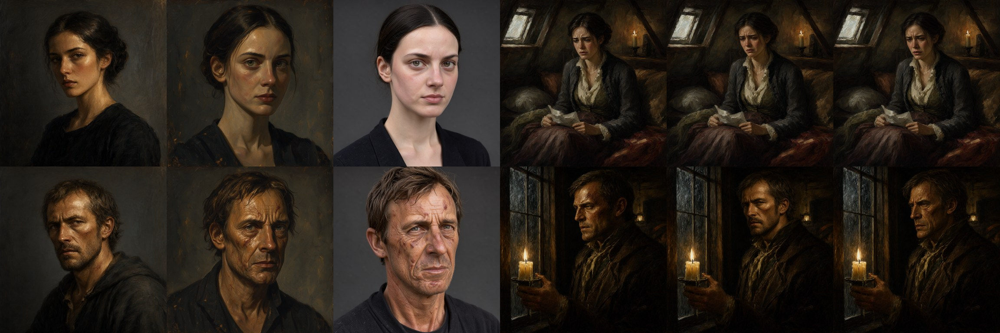

The faces, cropped to the box the edit found: the portraits above, the scene and its three edits below.

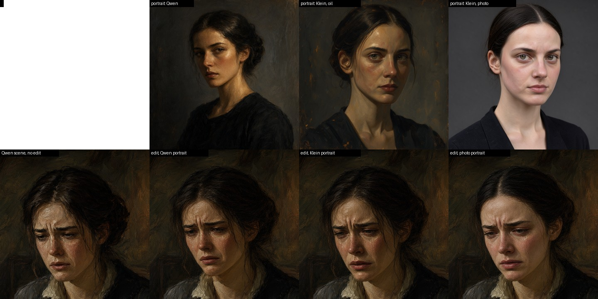
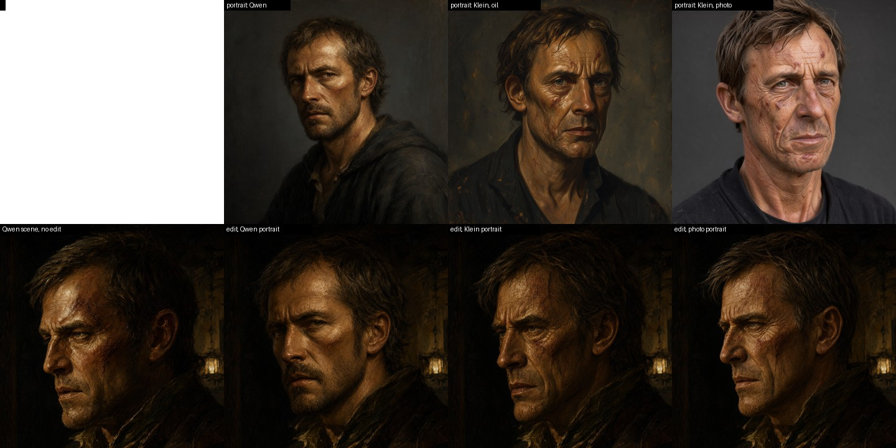

FLUX.3 Klein's scenes, edited with the Qwen portraits.

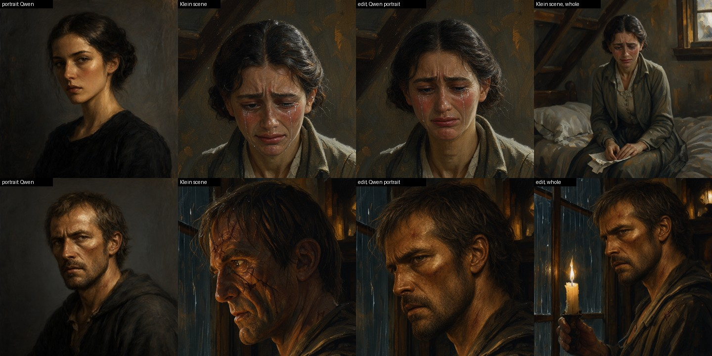

## Character sheets (the PC)

Qwen-Image 2.1's sheets, 17–19 s each.

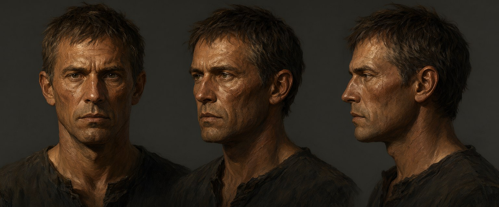
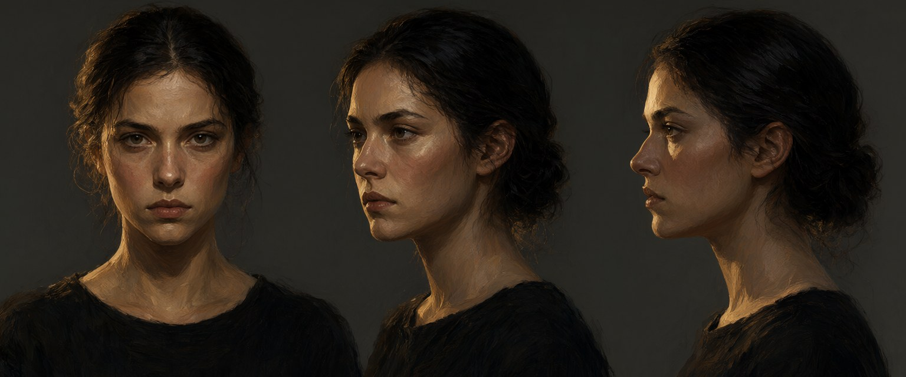

Kael's profile, face edits with the turned portrait, the whole sheet, its profile view and its front view, two seeds.

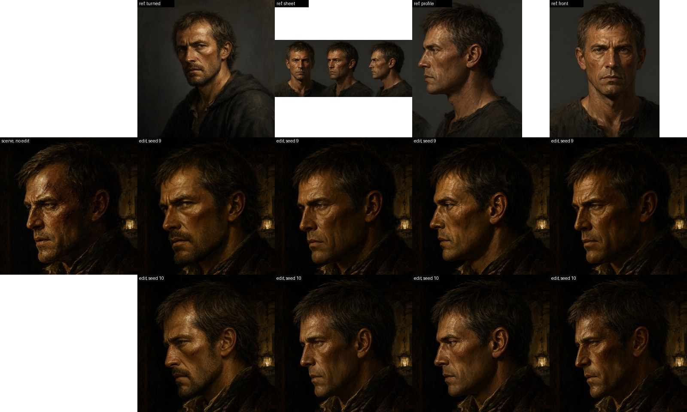

Elara crying, the same with her portrait, sheet, front and three-quarter views.

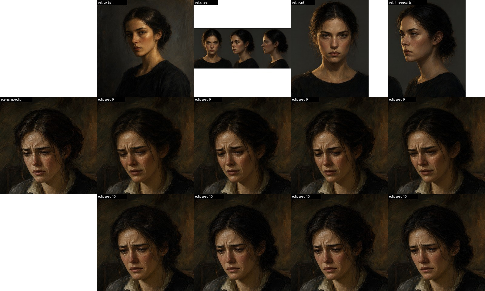

One pass: each scene without a reference, with the portrait, and with the sheet, two seeds.

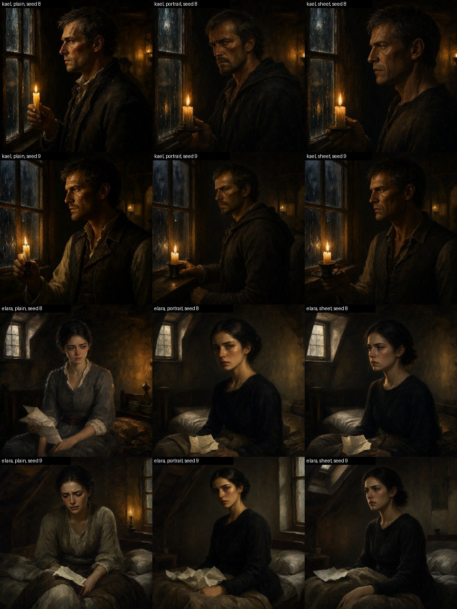

Kael's sheet by FLUX.3 Klein (11 s) and FIBO 2.0 Turbo (9 s), and the face edits with each beside Qwen's.

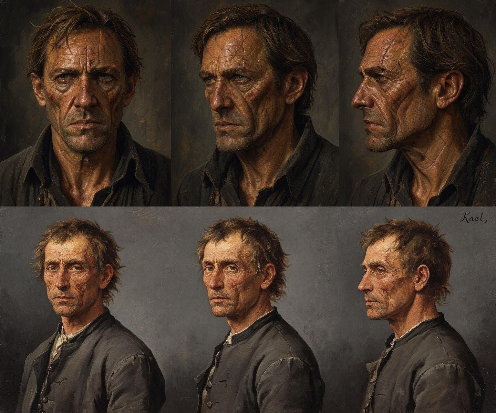
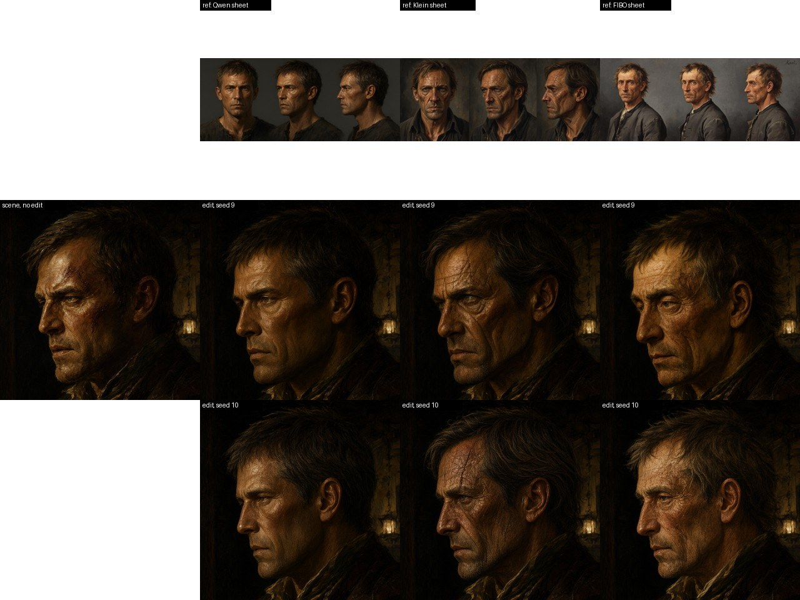

## Full size

The collages shrink whole pictures; these are at the pictures' own resolution, where faces, brushwork and tears show.

Kael's face: the scene, then the edits with the turned portrait, the whole sheet and its profile view (the PC, seed 9).

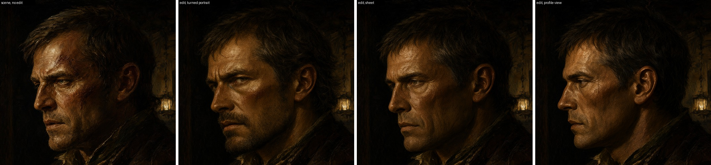

One pass, whole pictures: without a reference, with the portrait, with the sheet (the PC, seed 8).

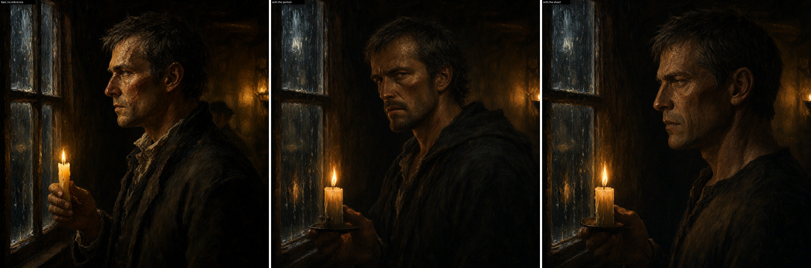
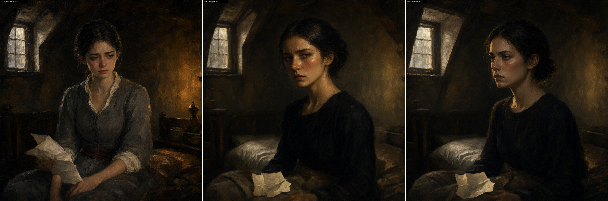

A photograph portrait, repainted in the scene's oil (the Mac).

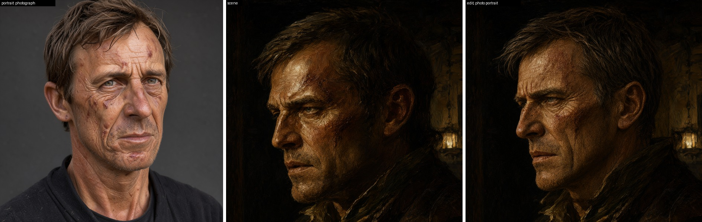

A FLUX.3 Klein Frame, its face repainted from a Qwen-Image 2.1 portrait (the Mac).

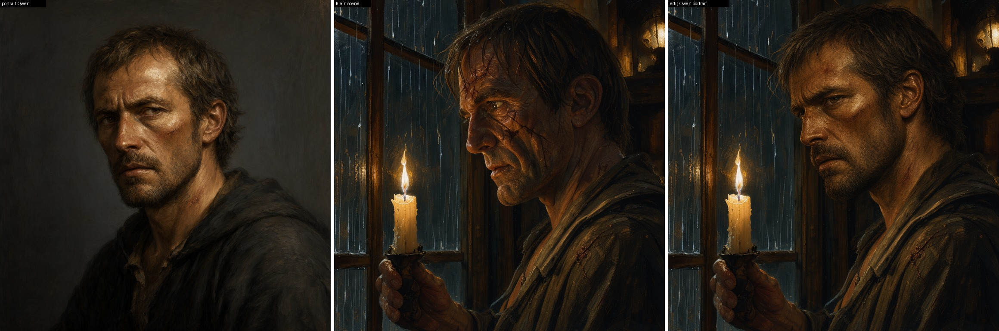

The face edit with the Qwen, FLUX.3 Klein and FIBO 2.0 Turbo sheets (the PC, seed 9), and the other two sheets whole.

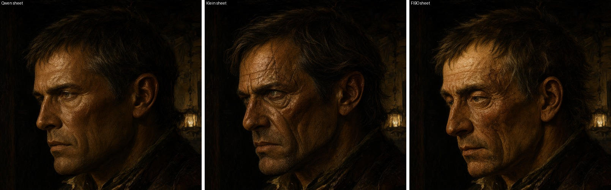
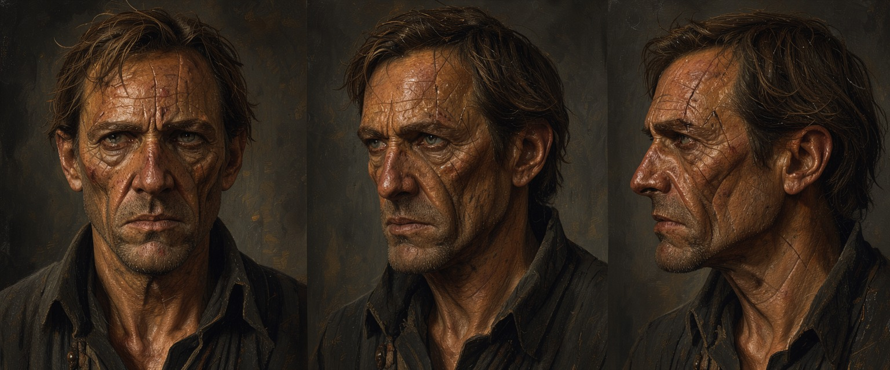
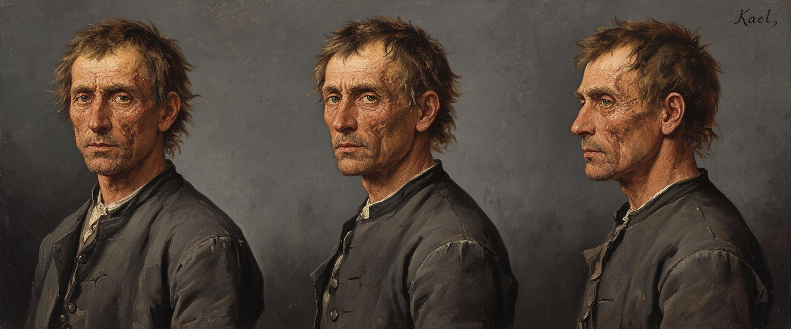

Elara: the scene, and the edits with her portrait and sheet; still crying, the face hardly changed (the PC, seed 9).

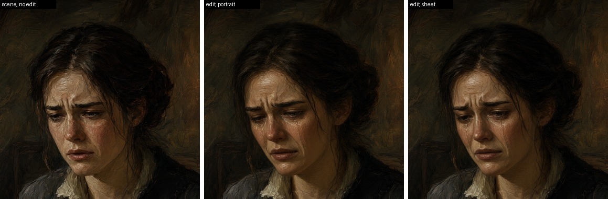
