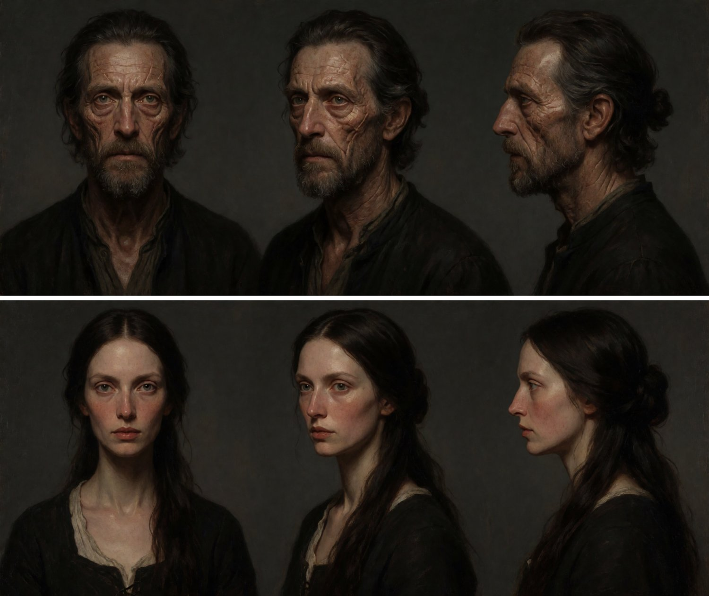
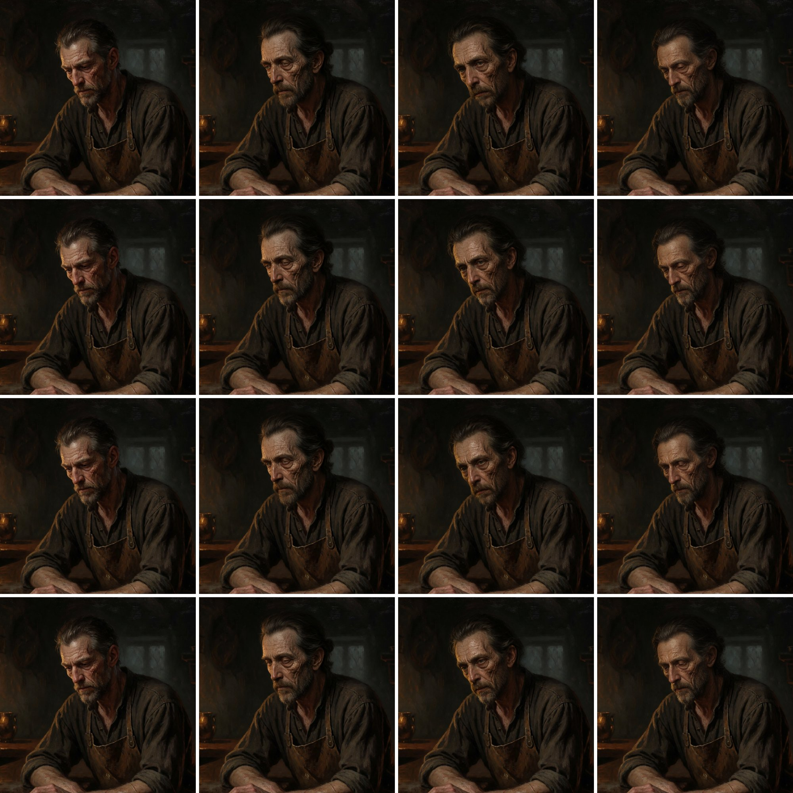
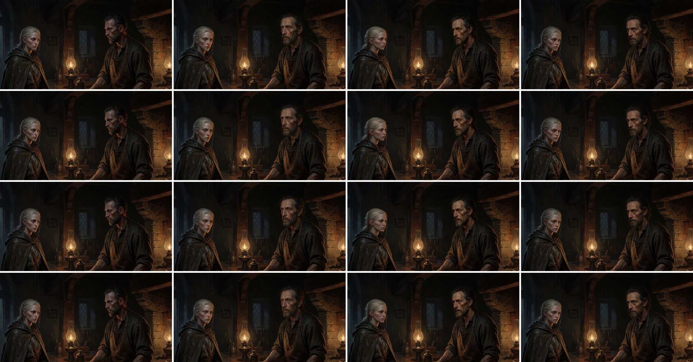
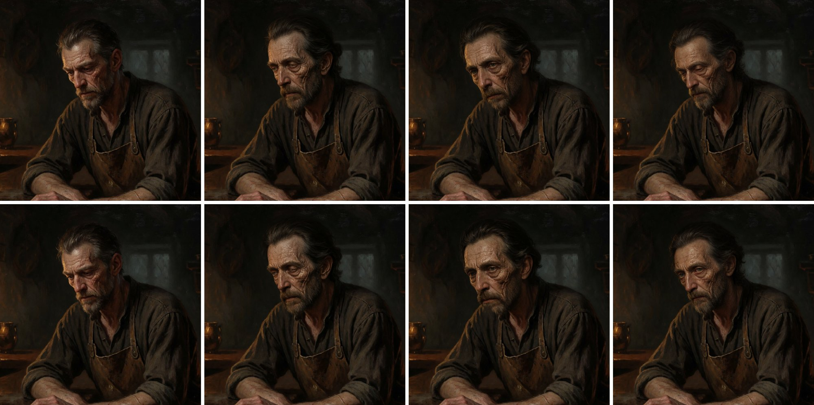
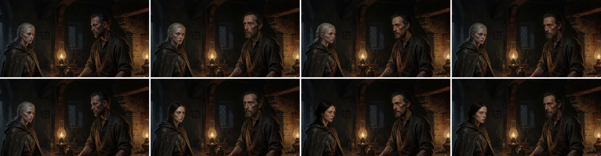
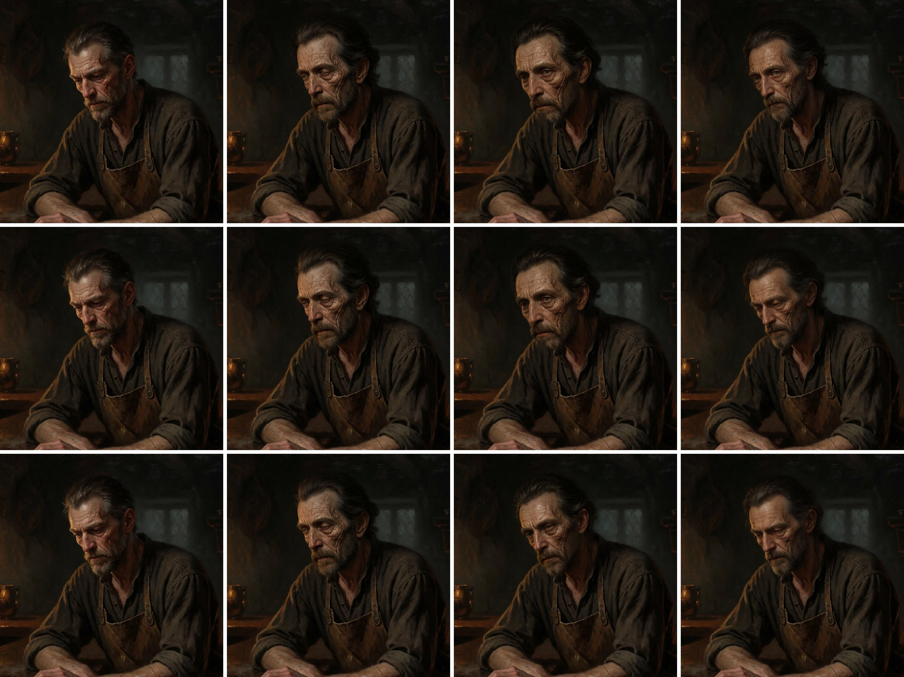
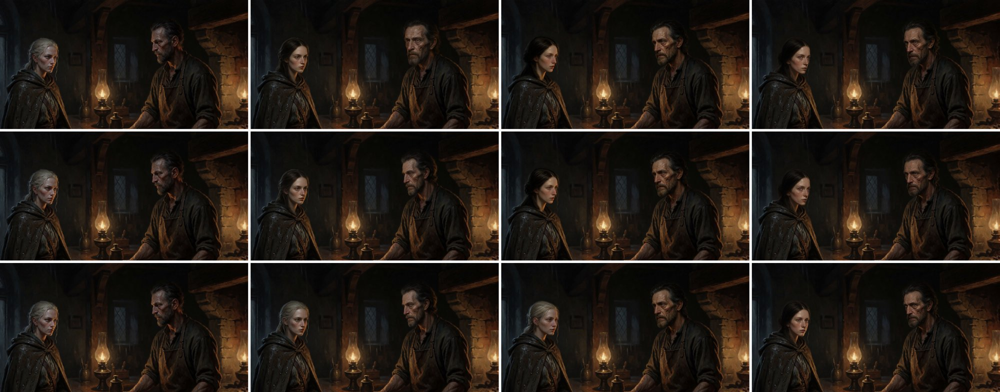
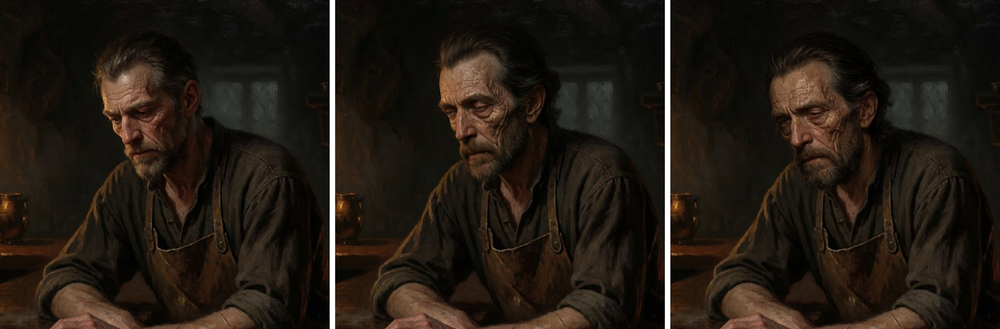

# Reference sheets, stage 4: the face pass through the app (2026-11-26)

The face pass of [reference sheets](../../../research/people-in-pictures.md#reference-sheets-as-built-2026-11-26) as built in stage 4 (`server/faces/`), run on real pictures: what it did, and the four things tried to fix what it did wrong. What was decided is in [research](../../../research/people-in-pictures.md#4-the-face-pass-after-each-render-done-2026-11-26), stage 4; this page keeps the pictures and the numbers, for the [showcase](../../../showcase/README.md).

Everything here is the public tavern Scenario (`example-scenarios/tavern.md`), made with `deno task replay server/replay/replays/tavern-sheets.yaml` (seed 7): the Cast, Kael's and Elara's sheets, the opening and one Message, each pictured. Rendered by the Session's Image Model, Krea 2 + LoRA, on the Windows PC's ComfyUI 0.46.3, sent from the Mac; the face pass by Qwen-Image 2.1 (int8) on the same ComfyUI, unless it says the Mac. Two Frames: Kael alone at the bar, his gaze lowered; and Kael in profile at the bar, looking at Elara, who faces him.

`seeds.ts` runs the app's own face pass (`twoPasses`) on the two renders at the seeds given (`deno run -A seeds.ts <comfy address> <session folder> <out> 8,10,11 <frame>…`, its header says how); `results/runs.txt` has every pass's time.

## In short

- **Through the app it works end to end**: each render saved, then its faces repainted from the sheets, the render kept beside them; nothing outside the painted areas changes (measured: the corners differ by 0).
- **With the sheet whole (stage 0's way), two faults**: Kael's head grew taller and less bowed on two seeds of three, and in profile beside Elara he turned to face the viewer on every seed, losing his look at her; Elara barely moved, keeping her render's blonde hair against her sheet's dark.
- **Neither the area nor the wording fixed them**: the box grown by 8% with a hard edge, and an instruction saying to keep the head's size, place and turn, gave much the same pictures seed for seed. The seed decided, not the variant.
- **One view of the sheet, nearest the head's turn**, gave Elara her sheet's face and hair on every seed, but Kael still turned to the viewer: Qwen3-VL had read his turn right ("three-quarter left"), so the view wasn't the cause.
- **Started part-way from the render** (one view, strength 0.96 where 1 is from noise), Kael kept his look at Elara on every seed, Elara still took her sheet, and the lowered gaze held; at 0.92 Elara mostly stayed as rendered. Kael's head is still a little tall on one seed (10) at every strength. So the face pass is one view at 0.96, for Qwen-Image 2.1 Edit (`EDIT_MODELS`' `faces.strength`).
- **With one head as the reference, no sheet can be pasted in**, so the heads aren't counted before and after any more (stage 0's check, which flagged nothing in these 30 passes).
- **Times on the PC**: finding a head 5–9 s; each face edit ~54 s, about twice the stage 0 bench's 28 s, which used Qwen-Image 2.1's step cache (`QwenImage21Cache`) where the app's edit workflow has none; the two counts ~14 s together, while there were counts. A Frame of Kael alone took ~63 s after its 18 s render at 0.96, two people ~124 s.

## The sheets

Kael's and Elara's, by Krea 2 + LoRA at seeds 7 and 8. Elara's identity names no hair colour, so her sheet's is dark and her render's blonde.

## The sheet whole, and three ways to fix it

Each row a variant, each the render then seeds 8, 10 and 11: the app's first build (the sheet whole, the box grown by a fifth and softened); the box grown by 8%, a hard edge; an instruction keeping the head's size, place and turn; both.

## One view

The sheet whole (top), then the view nearest each head's turn (bottom): Elara takes her sheet; Kael still turns to the viewer.

## Part-way from the render

One view at strength 1 (from noise), 0.96 and 0.92, top to bottom.

## On the Mac

The same Frame of Kael alone, rendered on the PC as the Session's Image Model does, then given its face pass through the running app on this Mac's mflux 0.24.0 (Qwen-Image 2.1, 8-bit, one view, `--strength 0.96`, seed 8): finding his head took 7.4 s (mflux's `_vision_reply`), the face edit 199 s, against 55 s on the PC; the Mac's available memory went from 27.5 GB to 11.7 GB at its least (`docs/bench/memory.ts`), with nothing loaded in Ollama as it began. Left to right: the render, the PC's pass at the same seed and strength, the Mac's. mflux's `--strength` does as ComfyUI's denoise: the sheet's face, the gaze lowered, the head its size.

A first try was cut off when an edit under `server/` restarted the development server mid-pass (`--watch`): the queue put the job back and it ran again from the start, as designed, but the cut-off pass left its painted area behind (`mask-…png`), as a restart ends work before it cleans up. Deleted by hand.
