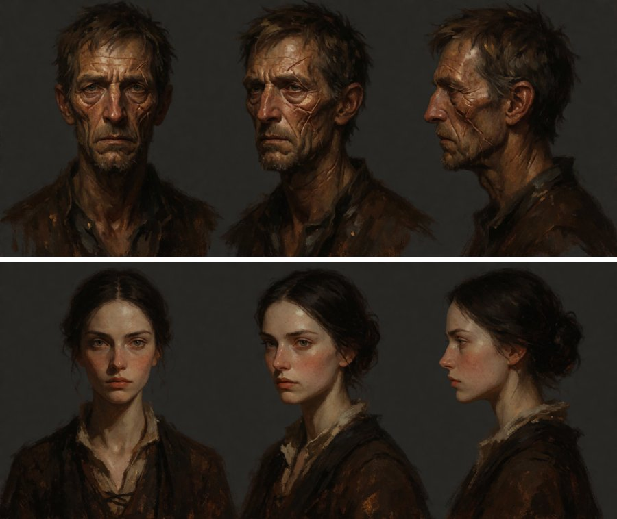
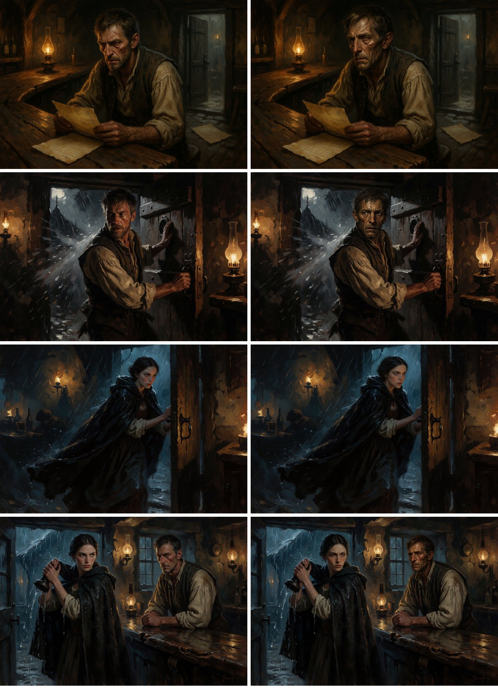
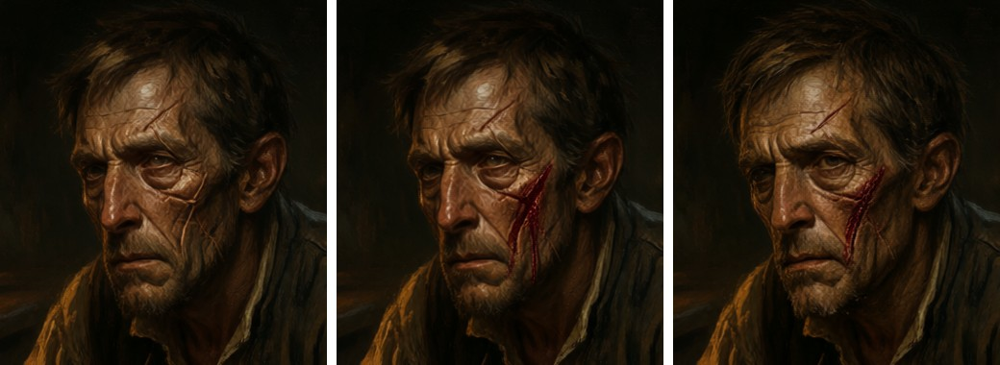
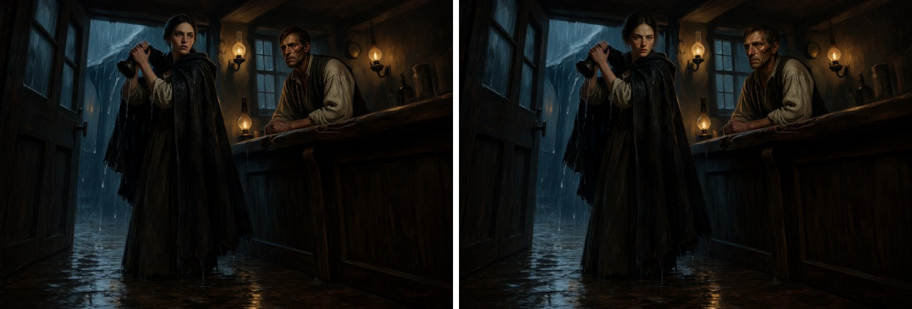
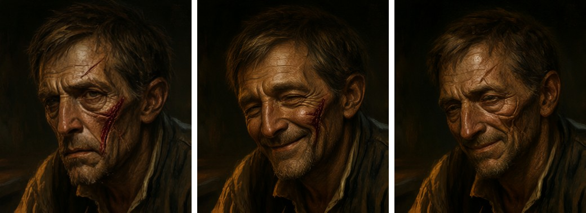
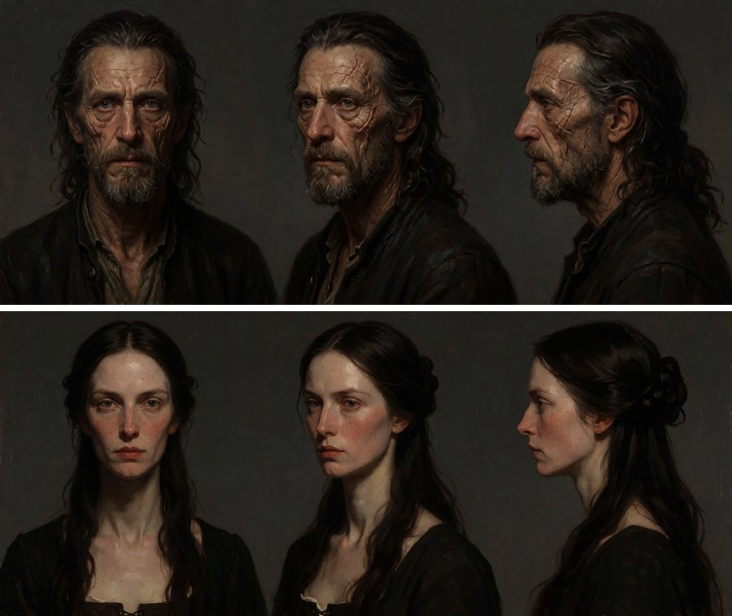

# Reference sheets through the running app (2026-11-26)

Checks of [reference sheets](../../../../research/people-in-pictures.md#reference-sheets-as-built-2026-11-26) as built, through the running app rather than the tests: what the stages had left "not yet through the app" ([open threads](../../../../open-threads.md)). Nothing was changed for them; what they found is in [research](../../../../research/people-in-pictures.md#still-open).

Everything here is the public tavern Scenario (`example-scenarios/tavern.md`), Kael and Elara Vance.

## A Storyboard with sheets

`deno task replay server/replay/replays/tavern-storyboard-sheets.yaml` (seed 7, four Frames, sheets on): the plan, then the Look and a sheet of each Subject, Write Frames, and a render of each Frame with its face pass. Rendered by the Session's Image Model, Krea 2 + LoRA, on the Windows PC's ComfyUI 0.46.3, sent from the Mac; the sheets' check and the face pass by Qwen-Image 2.1 (int8) on the same ComfyUI, Settings' edits pointed there for the run and put back after. Then two edits through the app (`../edits/edit.sh`): a painted area over Kael's head in Frame 1 ("A fresh red cut across the man's left cheek.", Qwen-Image 2.1 Edit), and the Camera list's low angle over Frame 4 (Qwen-Image 2.1 Turbo Edit, Settings' edit model). Logs in `results/`.

- **It works end to end, and found no bug.** The plan 9 s; Kael's and Elara's sheets 35 s each (render and check), both fit; Write Frames 86 s, about 70 s of it waiting for the sheets, as built (`whenGone`); each Frame's expression sentence kept apart from its body. Each render then had its face pass, the render kept beside it: Frames 1 and 2 (Kael) and 3 (Elara) 76–80 s each (render ~18 s, finding the head ~7 s, the face edit 52–54 s), Frame 4 (both) 135 s (finding 11.7 s, the two face edits 105 s). The seeds as ADR 0011 says: the face pass at the render's seed plus one, an edit one on from its source's last, its pass one on again.
- **The painted cut kept through its face pass**, Kael's face still his sheet's (86 s: the edit 27 s, finding 6.6 s, the face 52 s). **The low angle repainted both faces** (141 s: the edit 17 s, finding 13.3 s, the faces 110 s).
- **By eye**: Kael took his sheet's face in every Frame, keeping his startled, wide eyes in Frame 2; Elara's face barely moved (as in every bench before: watch in play). In Frame 4 Kael kept his head's turn towards Elara, but his "guarded, unblinking gaze" became wearier and softer: another expression softened (open threads).
- **On screen** (`deno task shot`): Frame 1 shows the edit with its Edited and Faces from sheets chips.

The sheets, then each Frame's render beside its face pass:

Kael's head in Frame 1: its face pass, the painted cut, then the cut's face pass. And Frame 4's low angle, before and after its face pass:

## "Make him smile" with nothing painted

After the Edit dialog's Camera list's wording was marked as a camera move (`EditOrder.camera`), and any other edit of the whole picture told its change (`face-edited.md`): "The man is smiling warmly, his eyes crinkled." with nothing painted, Qwen-Image 2.1 Edit on Frame 1 (made from the painted cut above), on the PC, one seed (`results/smile-edit.log`): 84 s, the edit 25 s, finding Kael's head 6.7 s, his face 52 s.

- **The smile kept through the face pass**, a little softer, Kael's face his sheet's. Stage 5's bench had found this wording kept it 3 of 3 for a painted area; before this change it was told the Frame's expression, which put a smile back to weary 3 of 3.
- **The cut of the edit before faded**: the pass named only this edit's change, so an earlier edit's change is painted out as the Frame's marks are (open threads: marks on a face).

The source (the cut, after its pass), the smile edit, and its face pass:

## Sheets made on mflux and checked there

`deno task replay server/replay/replays/tavern-sheets.yaml --no-pictures --on mflux` on this Mac (mflux 0.24.0, 8-bit; the Session's Krea 2 + LoRA for the sheets, Qwen-Image 2.1's Qwen3-VL for the check; gemma-4-26b-heretic nvfp4 in Ollama writing the Cast, the opening and one Message meanwhile): until now the check had run on mflux only on the PC's sheets.

- **Both sheets made, checked and found fit on the Mac**: Kael's in 120 s, Elara's in 107 s, render and check together (the call log was off, so not split). Both fit by eye too: three views in order, no writing, no lamp.
- **The Message sent meanwhile took 122 s**, waiting for the sheets, as stages 2e and 3 found (open threads: sheets on one Mac hold up the Text Model).
- **Memory** (`docs/bench/memory.ts`): available from 31.2 GB at the start to 5.3 GB at its least, with the Text Model loaded beside the sheet's render and check.

## Not done here

- The PC's own run of the app: only on the PC.
- A ComfyUI job after the Mac sleeps: needs the lid closed mid-job.
- Not kept: the mflux Session, deleted after; the Storyboard, kept for the benches that follow and deleted after them.
