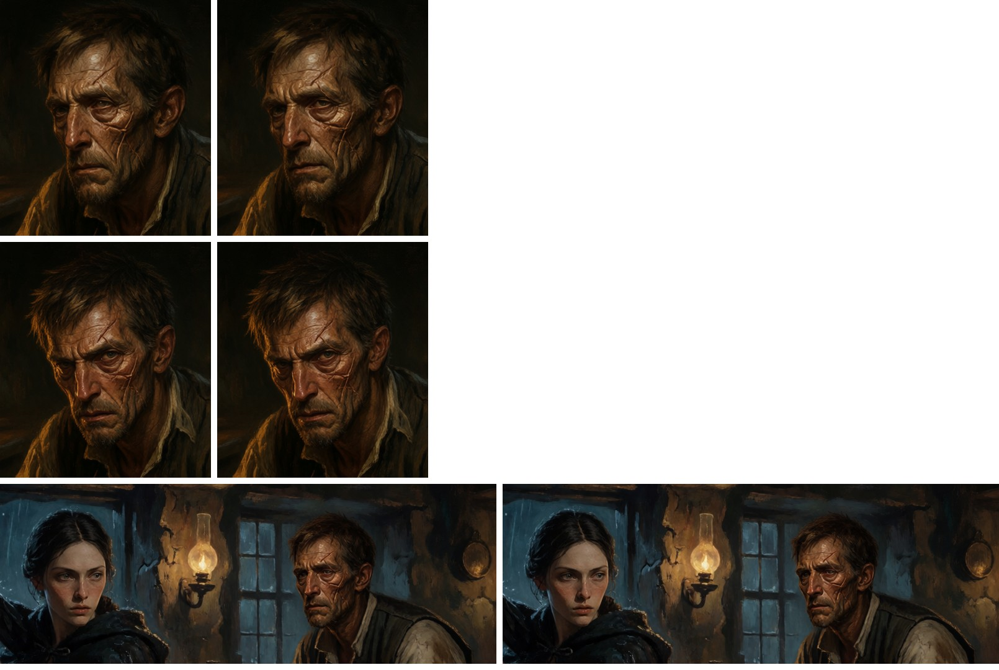
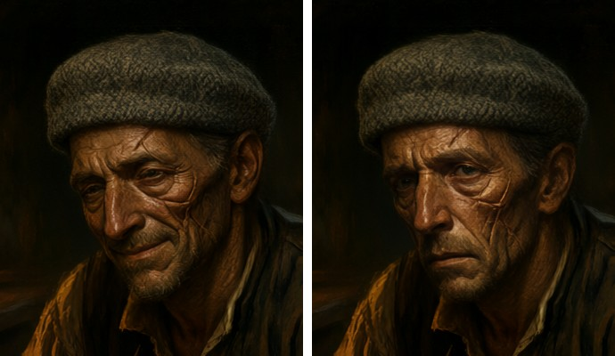
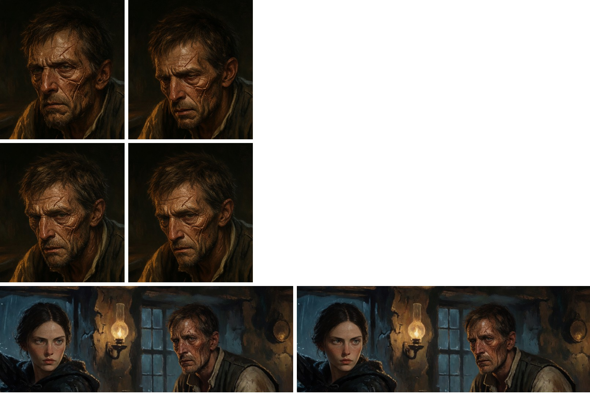
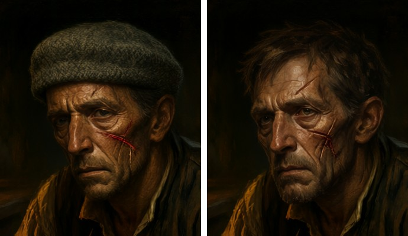

# The face edit's caches, on the PC and the Mac (2026-11-26)

The face pass's edit on the PC took ~53 s a face, about twice the 28 s of the stage 0 bench, which had Qwen-Image 2.1's `QwenImage21Cache` where the app's edit workflow (`qwen-image-2.1-edit.json`) didn't ([stage 4](../README.md)). Despite the open thread's name, it isn't a step cache: it keeps the text's and the reference images' share of the attention between steps (as mflux's `--use-kv-cache`, on by default for the Mac's edits, does), and on 2026-11-22 all five of its settings drew the same picture, `gpu` at `int8` nearly halving a render with two portraits (52 s to 27 s), while `auto` put it in RAM on the PC and gained nothing ([research](../../../../research/people-in-pictures.md#reference-portraits-for-subject-consistency-open-thread)). A plain render, with no references, gained nothing from it on ComfyUI 0.46 ([upgrade log](../../../../research/comfyui-upgrade-log.md)). The face edit has two images (the picture and the sheet's view), so what was left to check was the time and that the faces come out the same, through the app's own face pass.

The Windows PC's ComfyUI 0.46.3 (RTX 4070), sent from the Mac: two Frames of the tavern Storyboard made with sheets earlier the same day ([app/](../app/README.md)), Kael alone (Frame 1) and Elara with Kael (Frame 4), their renders face-passed by the app's code (`../edits/passes.ts`, `run.sh`) at seeds 8 and 9, told the Frame's expression, once with the workflow as it was and once with `QwenImage21Cache` at `gpu`, `int8` before the sampler.

## What was found

- **Faster by ~40%**: a face pass of one person 60–61 s without, 37–39 s with; of two 120–121 s without, 75 s with. Each includes finding the heads (~7 s a person), so a face edit went from ~53 s to ~31 s.
- **The same faces**: a mean difference of 0.1–0.4 levels in 255 between the two, under 1.7% of pixels differing by more than 8 levels, all in the repainted heads; side by side at full size, only fine wrinkle detail moves.
- **Through the app** (the cache in the app's workflow; a cap painted over Kael's head in Frame 1 by Qwen-Image 2.1 Edit, then its face pass, `results/through-the-app.log`): 66 s in all, the player's edit 25 s (as before: one image, little to cache), finding the head 7 s, the face 31 s; against 84–86 s for the same kind of edit before. The cap was kept. The smile of the edit before it wasn't: the pass names only this edit's change (open threads, with the faded cut).
- **The 12 GB card held it** with two people's faces at the edit's 1024² budget; when the cache doesn't fit, Qwen-Image 2.1 recomputes without it rather than fail (2026-11-22).

**Built**: `QwenImage21Cache` at `gpu`, `int8` in `qwen-image-2.1-edit.json`, so every Qwen-Image 2.1 Edit on a ComfyUI has it, the player's too. A Frame of one person with a sheet now takes ~55 s on the PC against ~18 s without, about the 3× Settings says.

Without the cache (left) and with it (right): Kael alone at seeds 8 and 9, then Elara and Kael at seed 8.

Through the app: the cap edit, then its face pass.

## The Mac: mflux's step cache

mflux already keeps the references' attention (`--use-kv-cache`, on by default), so the Mac's face edit, ~210 s a face, had nothing to gain from the PC's change. Its edit has a real step cache too, off by default: `--use-step-cache` skips transformer blocks on steps much like the one before, "faster, slightly different output" (mflux's help), and nothing under 10 steps. Asked by the owner to run it: the same two Frames and seeds through the app's face pass on this Mac (mflux 0.24.0, 8-bit, M5 Pro 48 GB, nothing loaded in Ollama), once as the app ran it and once with `--use-step-cache` added by a wrapper earlier on the PATH (`bin/`, `passes-mflux.ts`, `run-mac.sh`), so the app was unchanged for the run; the flag was seen in the running edit's command line.

| Face pass (finding included) | Without | With `--use-step-cache` |
|---|---:|---:|
| Kael alone, seed 8 | 211 s | 114 s |
| Kael alone, seed 9 | 208 s | 108 s |
| Elara and Kael, seed 8 | 420 s | 224 s |

- **About half the time**, a face edit ~200 s to ~100 s; available memory at its least 12.0–13.5 GB either way (`docs/bench/memory.ts`).
- **Nearly the same faces**: seed 9 and the two people all but identical (a mean difference of 0.27 and 0.17 levels in 255); seed 8 visibly a little different (mean 1.0, 4% of pixels by more than 8 levels): the same man, scars and expression, his gaze a touch lower and the scars' lines drawn a little differently.
- **Through the app** with it built (a cut painted over Kael's head in Frame 1 by Qwen-Image 2.1 Edit, made from the cap edit above, then its face pass; `results/mac-through-the-app.log`): 199 s in all, the player's edit 86 s (no earlier time for this edit model on the Mac to compare: stage 5 used the Turbo), finding the head 8.9 s, the face 103 s against ~211 s. The cut was kept; the cap of the edit before was painted out, the third time today a pass erased an earlier edit's change (open threads).

**Built**: `--use-step-cache` for mflux's Qwen-Image 2.1 Edit, always (`EDITORS`' `args`), the player's edits too, as the ComfyUI cache is; not for the Turbo's 8 steps. Not tied to Settings' step cache, which shows only for an Image Model that takes it. A Frame of one person with a sheet on the Mac is then ~3.5 min against ~1.5.

Without it (left) and with it (right), as the PC's figure:

Through the app: the cut edit, then its face pass (the cap painted out).

## The player's own edits with mflux's step cache (2026-11-26, the Mac)

Built for every Qwen-Image 2.1 Edit on mflux, the player's too, but measured only on the face pass. Two edits of the player's kind on the tavern Storyboard's renders, by the app's code (`edits-mflux.ts`, mflux 0.24.0, 8-bit, nothing loaded in Ollama), seed 10, once with the step cache as the app runs it and once with the flag taken out by the wrapper (`bin/`, `STEP_CACHE=0`), the app unchanged: a grey cap painted over Kael's head, and "Make the woman smile warmly." on Elara with nothing painted (`results/mac-player-edits.log`). The wrapper's echo of its arguments didn't reach the log (the app pipes mflux's stderr); the times show the flag did.

| Edit | Without | With `--use-step-cache` | Difference |
|---|---:|---:|---|
| The cap (painted) | 182 s | 107 s | a mean of 0.13 levels in 255, 0.2% of pixels by more than 8 |
| The smile (whole picture) | 194 s | 105 s | 0.96, 0.7% |

- **The same edits, in a little over half the time**: by eye the same cap and the same smile; available memory at its least 15.7–16.6 GB either way. Kept as built.

The render, then the edit without and with the step cache, for each:

## The Turbo edit's cache at `gpu` (2026-11-26, the PC)

The Turbo's edit workflow (`qwen-image-2.1-turbo-edit.json`) has `QwenImage21Cache` at `auto`, as ComfyUI's template has it; `auto` had put the base model's cache in RAM on the PC on 2026-11-22, with two portraits at 25 steps. Run by `turbo.ts`, the app's own ComfyUI edit, on the Windows PC's ComfyUI 0.46.3 sent from the Mac, once as the workflow is and once with the cache at `gpu`, `int8`, the PC's free RAM and VRAM watched through `/system_stats`: the Storyboard's renders before their face pass, a red cut painted over Kael's head (Frame 1), and the Camera list's low angle of Kael alone (Frame 1) and of Elara and Kael (Frame 4), seeds 10 and 11 (`results/turbo-auto.log`, `turbo-gpu.log`).

- **No faster**: 17.6–23.1 s an edit at `auto`, 16.5–20.1 s at `gpu`; the 8 steps themselves 3.0–3.4 s against 2.9–4.0 s. The rest of the ~18 s is loading the model, encoding and decoding, which the cache doesn't touch: with one image and 8 steps there's little to keep.
- **No RAM moved**: the PC's least free RAM was 8.1–8.5 GB either way, VRAM 0.7–1.2 GB, so `auto` didn't spill to RAM here.
- **The same pictures**: the painted cut a mean difference of 0.03 levels in 255, the low angles 0.8–1.5 (2–5% of pixels by more than 8), the same by eye.

**Kept at `auto`**, the template's, as `gpu` gains nothing. Rows: the cut, Kael's low angle, the two's; `auto` left, `gpu` right, seed 10.

## Not done

- **A ComfyUI on a Mac**: `gpu` there is untried, as this Mac's ComfyUI hasn't Qwen-Image 2.1's files; this Mac's ComfyUI 0.46.3 offers `auto`, `gpu`, `cpu` and `off` for it.

## Files

- `turbo.ts`: the Turbo's edits at the workflow's cache setting, timed, with the PC's free memory.
- `edits-mflux.ts`: the player's edits on mflux, with and without the step cache (`bin/`, `STEP_CACHE`).
- `run.sh`: the face pass on the two Frames on the PC, through `../edits/passes.ts`; `run-mac.sh`, `passes-mflux.ts` and `bin/`: the same on this Mac's mflux, without and with the step cache.
- `results/`: the PC's times without (`cache-off.log`) and with (`cache-on.log`) and its edit through the app; the Mac's (`mac-step-cache.log`, `mac-through-the-app.log`).
- Not kept: the passes' full-size pictures (in the figure). The Storyboard is kept for the benches that follow, and deleted after them.
