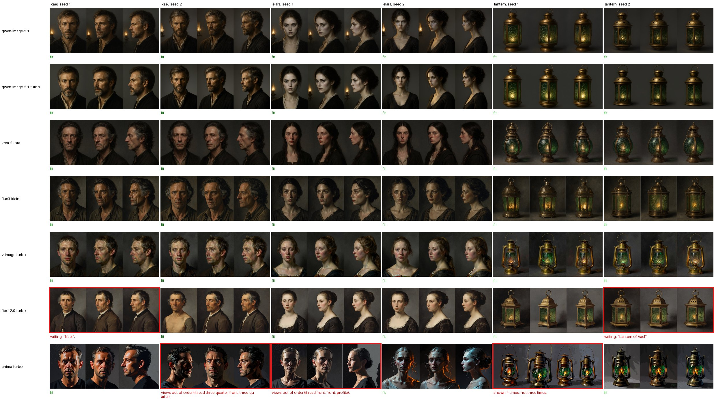

# Reference sheets, stage 6: checking a sheet before it's used (2026-11-26)

Whether the Qwen3-VL in Qwen-Image 2.1, which the face pass already finds heads with, can tell a reference sheet fit for the face pass from an unfit one, and with which questions. What was built from it is in [research](../../../../research/people-in-pictures.md#6-finishing-done-2026-11-26) and [ADR 0045](../../../../adr/0045-faces-are-repainted-from-a-reference-sheet.md); this page keeps the pictures and the numbers, for the [showcase](../../../../showcase/README.md).

What was known before (the [2026-11-25 sheet trials](../../../reference-portraits/2026-11-25/README.md), stage 2e): FIBO 2.0 Turbo's sheet wrote "Kael," in a corner and turned only the head; the tavern's style ("the warm, flickering light of oil lamps") put a lamp beside the face in Qwen-Image 2.1's sheets; and Qwen3-VL calls a profile facing left "profile right" (stage 0b), so a turn's side can't be relied on.

## What was run

- **42 sheets** (`check.ts render`): the app's sheet prompt (`server/prompts/sheets/sheet.md`) at 1536×640, for the public tavern Scenario's Kael and Elara (`example-scenarios/tavern.md`, the Look a replay wrote) and stage 0's Lantern of Vael, at seeds 1 and 2, by seven Image Models at their default steps, on the Windows PC's ComfyUI 0.46.3 sent from the Mac. Each was then judged by eye: three views of the Subject, a person's from the front, at a three-quarter turn and in profile, nothing written.
- **Five questions** about each (`check.ts ask`, the question files here): `whole.md` (everything in one object), `find.md` (the face pass's own question, as it was), `rest.md` (the backdrop, writing, anything else), `count.md` (every head, stage 0's count), `views.md` (how many times the Subject is shown, each one's turn).
- **The app's check** (`check.ts look`, `lookOver` and `sheetFlaw` in `server/heads/heads.ts`, with `views.md`, `count.md` and `rest.md` as the app's `views.md`, `count.md` and `sheet.md`): on all 42 on the PC, and on 10 of them (the five unfit and one fit of each other kind) on this Mac's mflux 0.24.0, 8-bit, asking the three questions in one load.
- **Through the running app**: the tavern replay with sheets by Anima Turbo (`deno task replay server/replay/replays/tavern-sheets.yaml --no-pictures --image-model anima-turbo --on comfyui`), Settings' edits (and so the check) sent to the PC for it, then put back.

## In short

- **By eye, five sheets of 42 were unfit**: FIBO 2.0 Turbo wrote on 2 of its 6 ("Kael." in a corner; "Lantern of Vael" under two views), Anima Turbo's were unfit in 3 of 6 (views out of order, front and front, four lanterns). Qwen-Image 2.1, its Turbo, Krea 2 + LoRA, FLUX.3 Klein and Z-Image Turbo drew six fit sheets each. Five of Qwen-Image 2.1's and its Turbo's eight people's sheets had a candle or oil lamp beside the face, from the style.
- **The face pass's own question can't count a sheet's views**: `find.md` answered the sheet's thirds as boxes (`[0, 0, 333, 1000]`…) rather than locating anything, and on all six Krea 2 sheets gave only one. **One question for everything** (`whole.md`) did the same with its views, and put the backdrop and writing inside each view.
- **`views.md` reads the turns**: on every fit person's sheet front → three-quarter → profile (either side), and on the unfit ones what's wrong: Anima's "front, front, profile", "three-quarter, front, three-quarter", and four lanterns. A thing's turns are noise (a clean lantern sheet read "three-quarter left, front, three-quarter right"), so **`count.md` says person or thing**: three heads on every person's sheet, none on every lantern's.
- **`rest.md` reads the writing**: "Kael" and "Lantern of Vael" on FIBO's two, and none on the other 40. It missed only a small signature in a corner of Anima's out-of-order sheet. It named the style's lamps (`others`), and read every backdrop as dark and plain, FIBO's mid-grey too, so the backdrop isn't judged.
- **The app's check agreed with the eye on all 42 on the PC**, 15.1 s a sheet (three questions, ~6, ~6 and ~4 s), **and with the PC on all 10 on the Mac**, 15–51 s a sheet in one load: about as fast as the PC with the Mac otherwise idle (16–19 s), slower while the replay's Text Model was running beside it. One question on mflux had taken ~21 s with the load (stage 2d), so three at once cost little more than one.
- **Through the app it made, checked, made again and kept**: Kael's Anima Turbo sheet was unfit at the Session's seed (7) and again at 8 (two near-fronts and a three-quarter, no profile), so it was kept at 8 saying why, the first one's files gone, in 51 s; Elara's passed at 8 in 27 s. The reason shows under Kael's sheet in Look & Cast.

## The sheets, and what the app's check said

A row per Image Model, Kael, Elara and the lantern at seeds 1 and 2; outlined, the five the check turned down, with why. The same five as by eye.

## A slip on the way

The first run on the Mac sent two of its three questions empty, and mflux answered each with a caption of the picture (an essay on a "Tischbein triptych"). The shell script stripped each question's `<!-- -->` note with a `sed` range, which deletes to the end of the file when the note opens and closes on one line. It wasn't the model: the same sheets, asked through the app's own code (`check.ts look mflux`), gave the PC's answers.

## Files

- `check.ts`: `render` makes the sheets, `ask` asks the question files of each, `look` runs the app's check on the PC's ComfyUI or this Mac's mflux. `figure.py` draws the figure (`uv run --with pillow`).
- The question files: `whole.md`, `find.md`, `rest.md`, `count.md`, `views.md`.
- `results/`: each question's replies and times (`answers-*.json`), the app's check on each machine (`looks-*.json`, `look-*.log`), the render times (`render-times.txt`).
- Not kept: the 42 sheets at full size (all in the figure), and the replay's Session.
