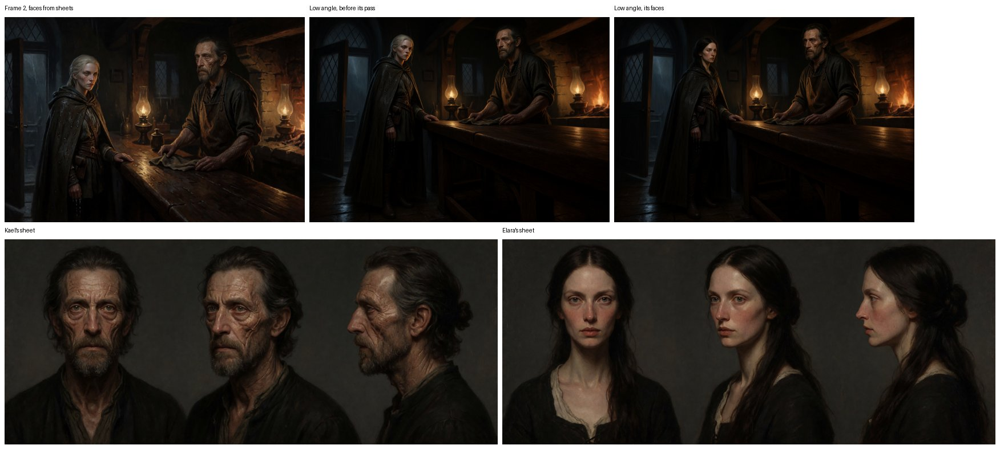
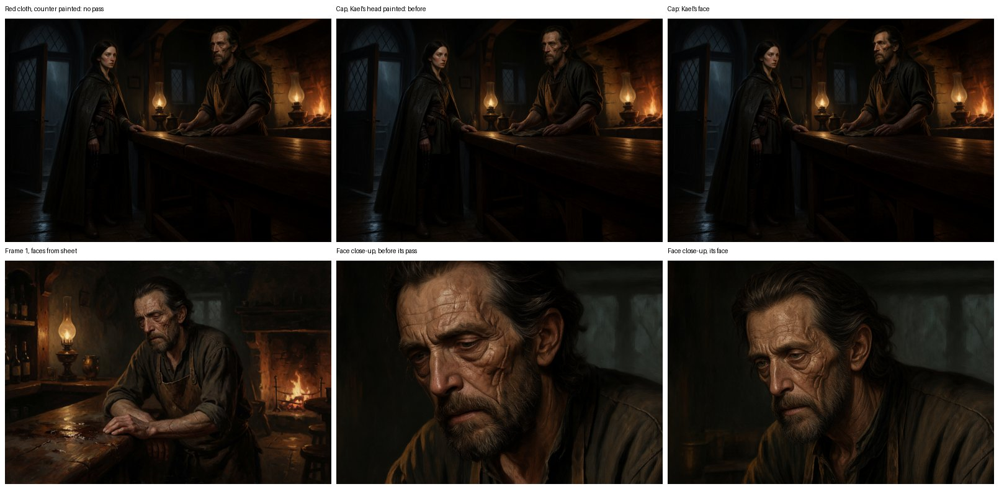
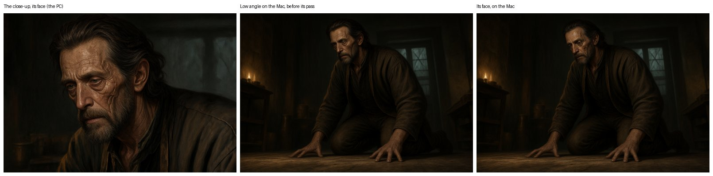
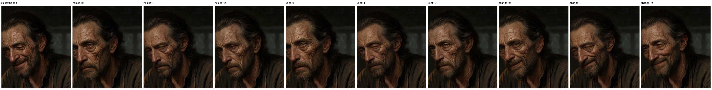
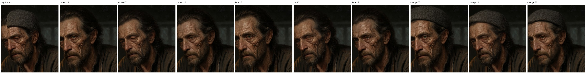
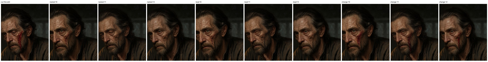
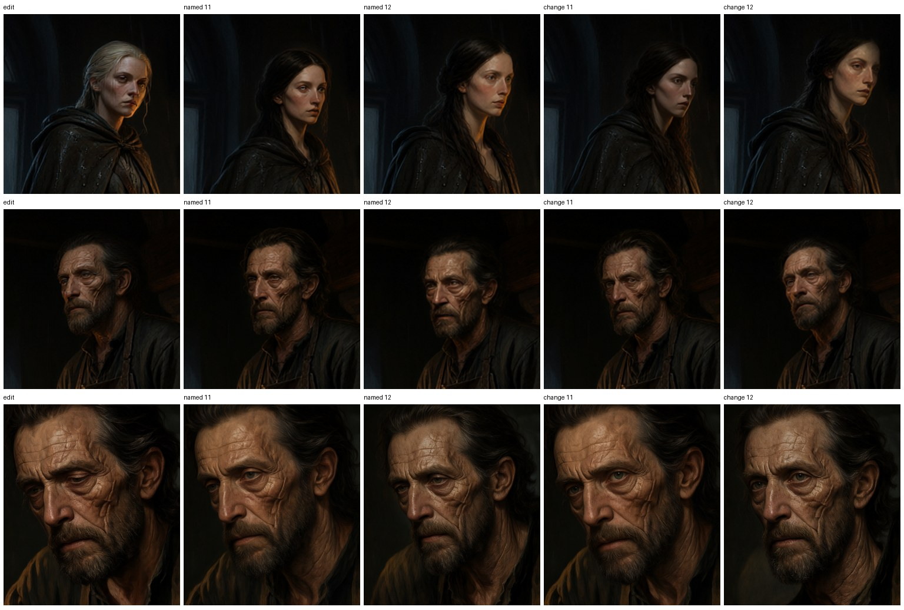
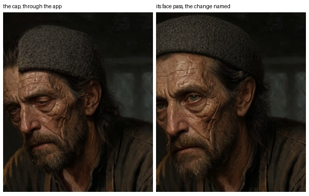

# Reference sheets, stage 5: the face pass after an edit (2026-11-26)

The face pass of [reference-sheets-plans.md](../../../../reference-sheets-plans.md) after the player's edit of a picture, as built in stage 5: the edit as before, then the face pass on its result in the same job, never one edit with both instructions. What it did through the app, how long it takes on each machine, and what it does to an edit of a face. What was decided is in the plan's stage 5; this page keeps the pictures and the numbers, for the [showcase](../../../../showcase/README.md).

Everything here is the public tavern Scenario (`example-scenarios/tavern.md`), in a clone of stage 4's Session (made by `deno task replay server/replay/replays/tavern-sheets.yaml`, seed 7): Kael alone at the bar (Frame 1), and Kael with Elara (Frame 2), each rendered by Krea 2 + LoRA and face-passed in stage 4. The edits are the app's (`edit.sh` queues one through the running app and times it); the PC is the Windows PC's ComfyUI 0.46.3 (Qwen-Image 2.1 int8), sent from the Mac; the Mac is its mflux 0.24.0 (8-bit).

## In short

- **Through the app it works end to end**: an edit is saved as it lands, then its faces are repainted from the sheets and saved as that version, with the edit before the pass kept beside it ("Without the face pass", as for a render); each edit is seeded one on from what it's made from, its face pass one on again (10, then 11 and 12 for two faces; the next edit 13).
- **Only the heads an edit touches**: a painted area over the counter left the faces as they were (30 s in all: the edit, and finding both heads); one over Kael's head repainted his face alone; an edit of the whole picture (a camera move) repainted both.
- **A camera move then its face pass keeps the sheet's face**: the low angle of Kael and Elara gave both their sheets' faces (Elara her sheet's dark hair, which the render's whole-sheet pass of stage 4 had left blonde), and a close-up of Kael's face kept his.
- **Times**: on the PC, an edit by Qwen-Image 2.1 Turbo Edit ~17 s, then finding the heads ~7 s a person and a face edit ~53 s each: ~78–85 s for an edit over one person, ~138 s over two. On the Mac, the Turbo's edit 47 s, finding Kael's head 7.8 s, his face edit 211 s, 266 s in all; available memory down from 23.1 GB to 11.8 GB.
- **An edit of a face was undone by the face pass as first built**: told the Frame's expression, the pass put back a smile, painted out a cap and a cut, on every seed; told nothing, the same. **Told the edit's own instruction as the change to keep, it kept all three on every seed.** But for a camera move, naming the move lost a close-up's lowered gaze where naming the Frame's expression kept it. So an edit of a painted area names its instruction, and an edit of the whole picture is told as a render is.

## A camera move, over two people

Frame 2 as it was (its faces from stage 4's pass), the Turbo's low angle (mostly a step back, as [ADR 0038](../../../../adr/0038-the-camera-is-moved-by-an-edit.md) found), then its face pass; the two sheets below.

## Painted areas, and a close-up

Top: a red cloth painted on the counter (the Turbo drew nothing much; no face touched, so no face pass), and a grey cap painted over Kael's head, before and after its pass (the Turbo drew no cap either). Bottom: Frame 1 as it was, the Turbo's close-up of Kael's face, and its pass.

## On the Mac

The low angle made on this Mac from the close-up (the newest of the Turbo's edits on Frame 1), then its face pass on mflux. The move went wrong, Kael kneeling on the floor, as ADR 0038 says the Turbo does with some angles; the pass then gave him his sheet's face as on the PC.

## An edit of a face, then its face pass

Three edits of Kael's face on Frame 1 by Qwen-Image 2.1 Edit on the PC, each over a box painted by hand around his head (`face-edits.sh`, through the app): "The man is smiling warmly, his eyes crinkled.", "A grey woollen cap on the man's head.", "A fresh red cut across the man's left cheek." Then the face pass on each edit at seeds 10, 11 and 12 by the app's own code (`passes.ts`, `face-bench.sh`), told three ways:

- **named**: the Frame's expression sentence named ("…a weary, stoic expression"), as a render's face pass is told (`face.md`); seed 10 is the app's own pass;
- **kept**: the expression kept "exactly as in image 1", nothing named (`face-unknown.md`): stage 0 had already found this loses an expression ("the same expression" lost Elara's tears), so this checks an old finding, not a new idea;
- **change**: that, and the edit's own instruction named as a change to keep (`face-edited.md`: "…the face and hair of the one in image 2, but keep what was changed in image 1: A grey woollen cap on the man's head. Keep Kael's expression exactly as in image 1…").

| Edit | named | kept | change |
|---|---|---|---|
| The smile | back to weary, 3 seeds of 3 | lost, 3 of 3 | kept, 3 of 3 |
| The cap | painted out, 3 of 3 | painted out, 3 of 3 | kept, 3 of 3 |
| The cut | gone, or a faint scar, 3 of 3 | a faint mark at most, 3 of 3 | kept, 3 of 3 |

Each pass ~60 s on the PC (a head found, one face edit). So the face pass after an edit names what the edit changed, as stage 0 found it must name what it keeps; told the Frame's expression, it puts back the moment the player edited away, and told nothing, it takes the sheet's face whole. The same finding as the Princess check's bruises (stage 4): the pass paints out what it isn't told to keep.

What this can't show: Kael's face here was already his sheet's (Frame 1 had its face pass), so whether the sheet's face still comes through with the change named is the next section's question, on edits that redraw the faces.

Each figure: the edit, then named, kept and change at seeds 10–12, Kael's head cropped at full size (`crops.py`).

## Camera moves, told either way

Would naming the edit's instruction suit every edit? The two camera moves above (the low angle of Kael and Elara, the close-up of Kael), each face-passed at seeds 11 and 12 with the Frame's expression named (as built) and with the move named as the change to keep (`camera-bench.sh`); ~117 s for the two people, ~59 s for one. Rows: Elara and Kael from the low angle, then the close-up; each the edit, then named and change at both seeds (`heads.py`).

- **The sheets' faces came through either way**: Elara took her sheet's dark hair and face in all four, Kael his in all eight.
- **The expression held better named**: in the close-up, with the Frame's sentence named, Kael kept his lowered gaze on both seeds; with the move named instead, his eyes came up towards the viewer on seed 11, and partly on 12.

## What was built from it

**An edit of a painted area names its instruction as the change to keep** (`face-edited.md`), as only the heads it touches get a pass, and those are what the player meant to change; **an edit of the whole picture (a camera move) is told as a render is**, its Frame's expression named. Left open: an edit of the whole picture that changes an expression ("make him smile", nothing painted) would still have its smile put back, as nothing tells the two kinds of whole-picture edit apart.

Then through the app (the PC, Qwen-Image 2.1 Edit over Kael's head, the cap): kept, the face his sheet's, the hard edge the edit left at the painted box smoothed; his gaze a little higher than the edit's. 84 s: the edit 25 s, finding his head 7 s, his face 52 s.

## Files

- `edit.sh`: queues an edit through the running app and prints its steps and times (`results/run*.log`, `mac-run.log`; the Mac's memory in `mac-mem.txt`).
- `face-edits.sh`: the three edits of Kael's face through the app, each kept aside and then deleted, so each is made from the Original.
- `passes.ts`: the app's face pass on given pictures and seeds, told one of the three ways; `face-bench.sh` and `camera-bench.sh` run it (`results/face-edits.log`, `camera.log`).
- `collage.py`, `crops.py`, `heads.py`: the figures (Pillow, through `uv run --with pillow`).
- Not kept: the passes' full-size pictures (in the figures), and the clone of the tavern Session they were made in.
