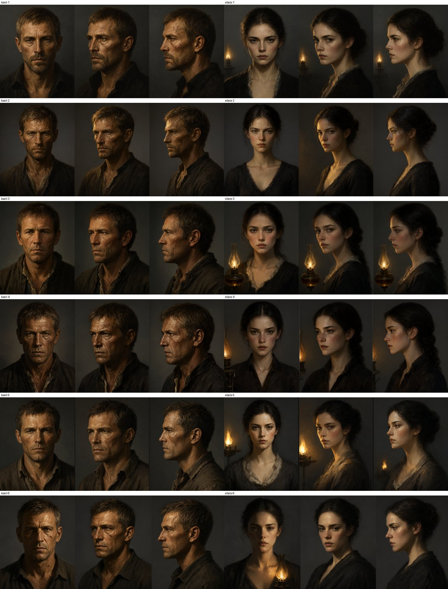
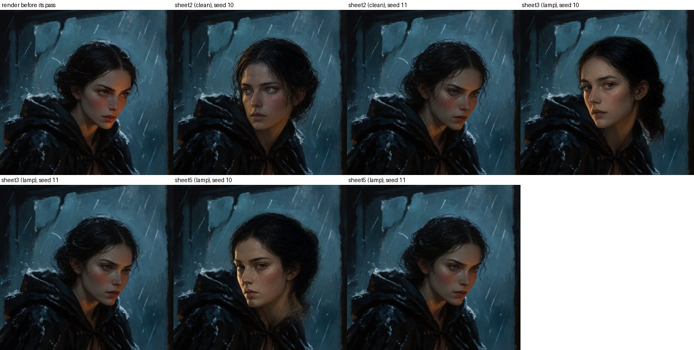

# The style's lamp in a reference sheet (2026-11-26)

A style that names its light's source puts it in the sheet: the tavern Roleplay's ("the warm, flickering light of oil lamps") put an oil lamp or a candle beside the face in every view of the 2e sheets, and in 5 of Qwen-Image 2.1's 8 people's sheets in [stage 6](../check/README.md), whose check names it (`others`) without judging it, as whether it harms the face pass was untried. Krea 2's sheets in the Storyboard had none.

On the Windows PC's ComfyUI 0.46.3, sent from the Mac. `sheets.ts` made sheets by Qwen-Image 2.1 with the app's sheet prompt (`sheetPrompt`) for the tavern Storyboard's Kael and Elara (`20261126-074629-4460`, the public `example-scenarios/tavern.md`) in the Roleplay's lamp-naming style, seeds 1–6, each checked (`lookOver`, `sheetFlaw`) and cut as the app does (`results/sheets.log`). `run.sh` then passed Elara's face on Frame 3's render (before its pass) from a sheet with a lamp beside her and from a clean one, seeds 10 and 11, by `../marks/passes.ts` (`results/passes.log`).

## What was found

- **The sheets** (17.7–20 s each, all fit): Kael had no lamp in any of 6; Elara a lamp or a candle beside her in 5 of 6 (seed 6 in the front view only), and seed 2 none. The check's `others` named each of the five and none elsewhere, agreeing with the eye on all 12 (`01-sheets.jpg`).
- **No lamp is pasted in**: from the sheets with a lamp beside her face in every view (seed 3) or close to it (seed 5), and from the clean one (seed 2), no pass of 6 drew a lamp, a flame or a glow by her (`02-passes.jpg`).
- **Its light can come with the face**: on seed 10 both lamp sheets lit her face warmly from the left, the lamp's side in those sheets, where the clean sheet kept the render's cold blue light from the door; on seed 11 all three changed her face little, as hers often barely moves. 2 of 4, small, and the clean sheet's seed-10 face was also turned a little.

So a lamp in a sheet is left noted, as built: it isn't pasted in, and turning such a sheet down would cost a render and a check (~33 s on the PC) for a warmer light on some faces. If it shows in play, the sheet prompt's "with nothing else in them" could name light sources ("no lamp or candle"), which stage 2e found took out one lamp of two.

## Files

- `sheets.ts`: the sheets, checked and cut. `run.sh`: Elara's passes from three of them.
- `results/`: each sheet's time, flaw and `others`; the passes' times and what each was told.
- Not kept: the sheets and passes at full size (in the figures).
