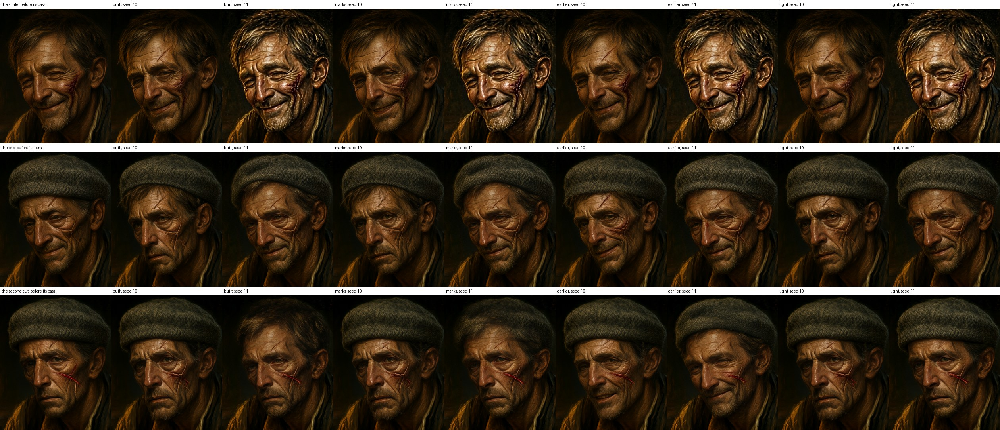
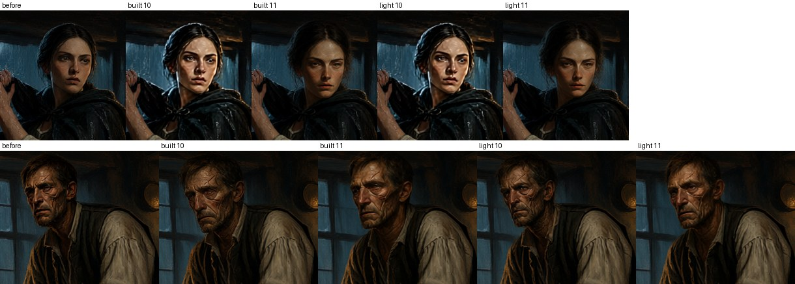
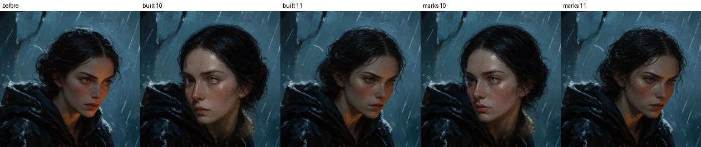
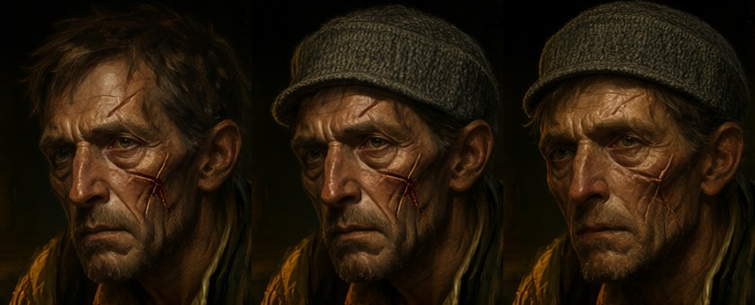

# Marks on a face, and an earlier edit's change (2026-11-26)

The face pass of [reference sheets](../../../../research/people-in-pictures.md#reference-sheets-as-built-2026-11-26) paints out what the sheet hasn't and its instruction doesn't name. Two cases were open: a render's marks (the Princess's bruises, gone in every pass of her rebuild with sheets, stage 4), and an earlier edit's change, painted out by a later edit's pass, which names only its own change (a cut faded, a smile and a cap lost, three times on 2026-11-26: [app/](../app/README.md), [cache/](../cache/README.md)). What was known before: the pass keeps what it's told by name (the expression, stage 0; an edit's own change, 3 of 3, [stage 5](../edits/README.md)), and "keep the expression exactly as in image 1" alone loses it (stage 0, and again in stage 5 by mistake), so that wasn't run again.

On the Windows PC's ComfyUI 0.46.3, sent from the Mac (Qwen-Image 2.1 Edit int8 with its cache at `gpu`): the app's own face pass (`twoPasses`) by `passes.ts`, which can add a sentence to its instruction through a wrapper round the edit model, so the app's prompts were unchanged for the runs; seeds 10 and 11 (the first edits 12 too, before the owner asked for two seeds), each pass ~36 s for one person, ~75 s for two. Pictures from the tavern Storyboard made with sheets that day (`20261126-074629-4460`, public: `example-scenarios/tavern.md`), and from the owner's Princess rebuild with sheets (`20261126-021922-b141`), whose text and pictures stay out of the repo: counted only.

## What was tried

On the picture each pass is made from (before its pass), told:

- **built**: as the app tells it (`face.md` with the Frame's expression for a render; `face-edited.md` with the edit's instruction for an edit);
- **marks**: that, and "Keep whatever is on <name>'s skin and head in image 1, such as marks, wounds, dirt, wetness or anything worn, exactly as it is.", one sentence right for any model and story;
- **earlier** (edits): every instruction in the edit's line, oldest first, named as the change to keep;
- **light** (edits): built, repainting each head at strength 0.9 against the app's 0.96, as an edit's picture already has its sheet's face from the pass before (stage 0 found the face changes only between 0.9 and 1);
- **bruise** (the Princess): her expression sentence and ", a dark bruise on her cheekbone";
- **worn** (the Princess): built, and "Keep what is on <name> in image 1: <the Frame's clothing sentence>", where her Frames write the bruise.

The cases: three edits of Kael's face on Frame 1, each made from the one before (`run.sh`): the smile (whole picture, made from the cut; its picture has the smile and the cut), the cap (painted; the cap and a faint smile, the cut already gone), the second cut (painted; the cap and the cut); Frame 4's low angle of Elara and Kael (`camera.sh`); Frame 3's render, Elara's face "damp from the rain" (named in its expression sentence); the Princess's Frames 1 and 4, her face alone.

## What was found

| Case | built | marks | earlier | light |
|---|---|---|---|---|
| The smile: keep the cut | kept 1, faint 1, gone 1 (of 3) | the same | kept 2, faint 1 | **kept 2 of 2** |
| The cap: keep the faint smile | faint on 2 of 3 | the same | the same, **the gone cut painted back** on 2 of 3 | the same as built |
| The second cut: keep the cap | **lost on 1 of 3** | **lost or faded on 2 of 3** | kept, **a smile painted back on 2 of 2** | **kept 2 of 2**, the cut too |

- **The general sentence does nothing**: it kept nothing built didn't, and lost the cap more often. On the Princess it kept her bruise on 0 of 4, as built did. The pass's "the face and hair of the one in image 2" outweighs it.
- **Naming the line's every change keeps them, and repaints what's gone**: the faded cut came back, and a smile on a face that had stopped smiling; it does every edit again, including one a later edit undid. Not built.
- **At 0.9 an edit's pass keeps more of what the edits added, the face still its sheet's**, a camera move's too: Frame 4's low angle gave both their sheets' faces at 0.9 as at 0.96 (`02-camera-move.jpg`). **Built**: an edit made from a version whose face pass is in use is repainted at 0.9 (`EDIT_MODELS`' `faces.again`); one made from a render shown without its face pass stays at 0.96, as a render's own pass does (stage 4: at 0.92 a face that barely moves stayed as rendered).
- **Naming the mark itself keeps it**: with the bruise named after her expression, it stayed on 4 of 4 (one smaller and lower), and her open-mouthed alarm on 1 of 2 (0 of 2 built).
- **Elara's damp face**, already named in her expression sentence, stayed damp, a little drier, built and with the sentence alike (`03-elara-damp.jpg`).

## Marks in the expression sentence: tried and reverted

So the pass would name marks if the Frame's expression sentence held them. In `shared/each-person.md` (the Art Agent's picture call, a Storyboard's write and edit), "anything on their face: blood, bruises, cuts, dirt, tears, wet" was moved from the clothing aspect to the expression's, and the Art Agent's picture call sent straight to Ollama over seeds 1–8 as the app builds it (`calls.ts`; this Mac, gemma-4-26b-heretic nvfp4, Thinking off; the Princess's own Text Model is no longer installed, so hers went to the same one): the tavern Roleplay `20261125-171251-1932`'s two Frames, and the Princess's Frames 1 and 4.

- As it was, her bruise was in the clothing sentence on 16 of 16 and the expression on 0 (`results/calls-tavern-old.log` for the tavern).
- Changed, her Frame 1 had it in the expression on 8 of 8; the tavern's faces gained only Kael's scars and damp skin, nothing made up (`calls-tavern-new.log`). No reply ended in whitespace either way.
- But her Frame 4 still wrote it in the clothing sentence (6 of 8), or not at all (2): each picture call is given "what each person wore when last pictured", the last Frame's clothing sentence, so that sentence carries what's on someone from Frame to Frame. With the earlier Frames' clothing sentences written without the bruise, as the change would write them, Frame 4 had it on only 3 of 8, never in the expression. So the change would lose marks along a story. Reverted.

## The clothing sentence named instead: built

So the face pass names the Frame's clothing sentence too ("Keep what is on <name> in image 1: …", `prompts/faces/worn.md`), after a render's or a camera move's instruction; not after an edit told its change, which may have changed what's on the head. On the Princess's two Frames (worn, seeds 10 and 11): her bruise kept on 3, faint on 1, against 0 of 4 built, nothing outside her head changed, and her alarm kept on 1 of 2. **Built for a Roleplay**, whose Frames keep their clothing sentence (`RoleplayImage.clothing`); a Storyboard's Frames don't keep it apart, so theirs would need `session.json` v6 (open threads).

## Through the app

- **An edit at 0.9** (the PC, Settings' edits pointed there for the run and put back): a grey cap painted over Kael's head on Frame 1 by Qwen-Image 2.1 Edit, made from the second cut's faces (`results/through-the-app.log`, `04-through-the-app.jpg`): the cap kept, his face his sheet's, 63 s (the edit ~27 s, finding 7 s, the face 30 s). The red cut of the edit before still faded to a scar: so at 0.9 an earlier change was kept 4 times of 5 across the bench and this run, against about 3.5 of 6 at 0.96. Better, not certain.
- **A Roleplay render with its clothing sentence named** (the PC): a Clone of the Princess rebuild, its Frame 1 rendered again (the same render, byte for byte, at the Session's seed), the face pass told her clothing sentence (seen in the call log): her bruise kept where the rebuild's own pass had painted it out, her face her sheet's; 57 s (the render 20 s, finding 7 s, the face 30 s). The Clone was deleted after.

## Figures

The three edits of Kael's face, before their passes, then each variant at seeds 10 and 11 (`01-edits.jpg`); Frame 4's low angle at 0.96 and 0.9 (`02-camera-move.jpg`); Elara's damp face, built and with the general sentence (`03-elara-damp.jpg`); through the app, the second cut's faces, the cap edit, its pass at 0.9 (`04-through-the-app.jpg`).

## Files

- `passes.ts`: the app's face pass on given pictures and seeds, with a sentence added (`marks` 1 or 2, `WORN`) or another strength (`STRENGTH`); `run.sh`, `more.sh`, `camera.sh` run it, the Princess's runs into a folder outside the repo.
- `calls.ts`: the Art Agent's picture call over seeds, printing its expression and clothing sentences.
- `results/`: the tavern's passes and the instructions each was told (`tavern.log`), the picture calls before and after the reverted change (`calls-tavern-*.log`), the edit through the app.
- Not kept: the passes' full-size pictures (in the figures), the Princess's pictures and logs, and the Clone.
