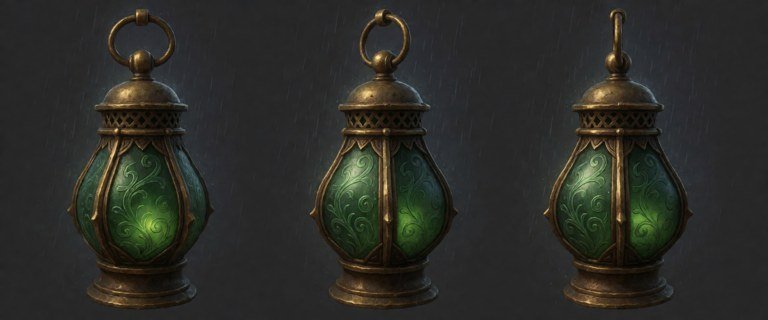
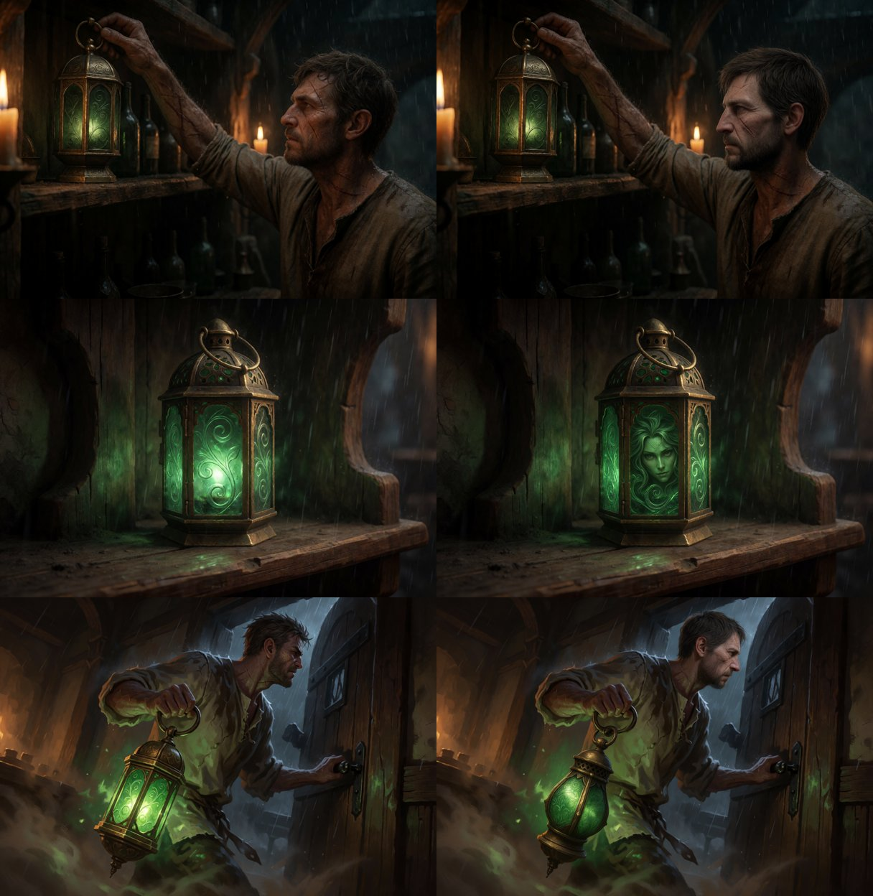
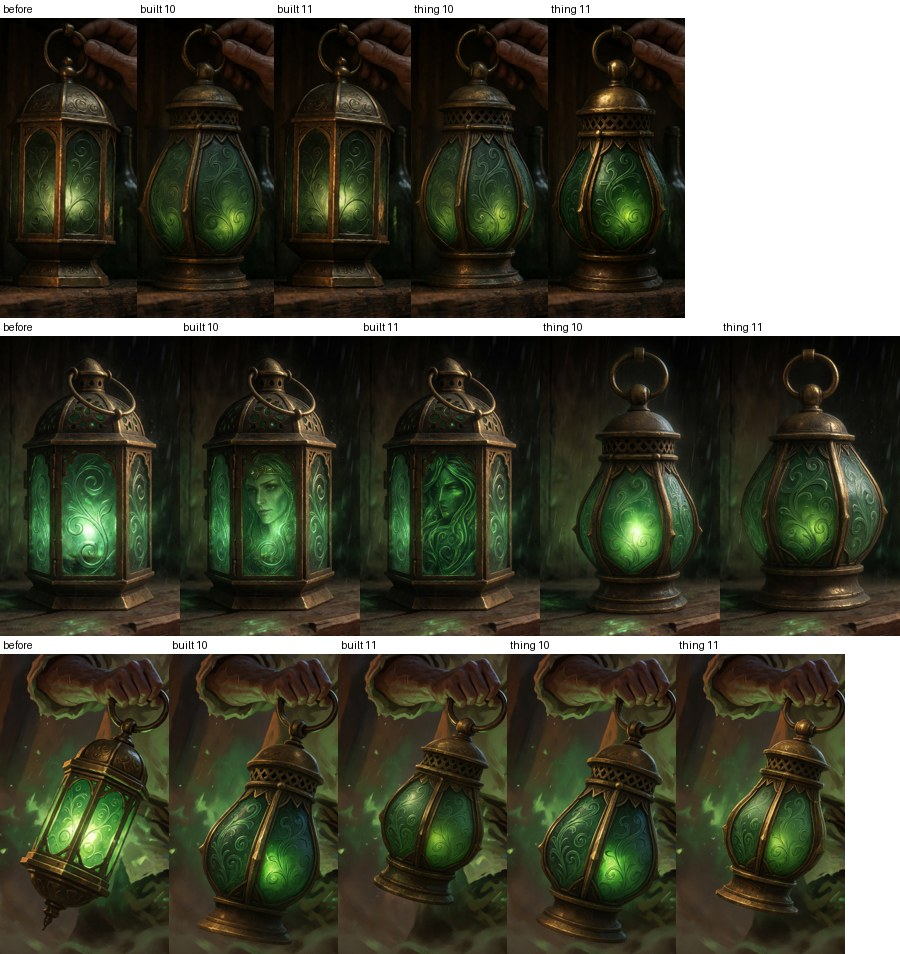
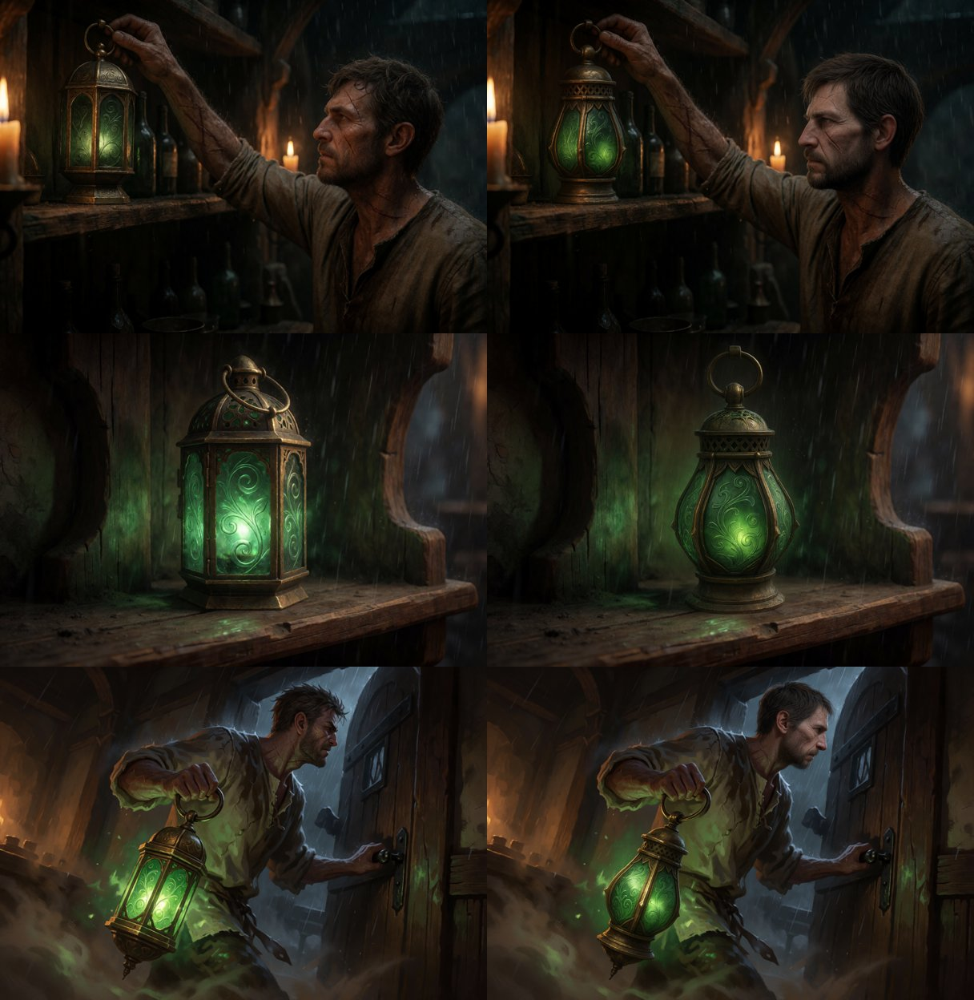
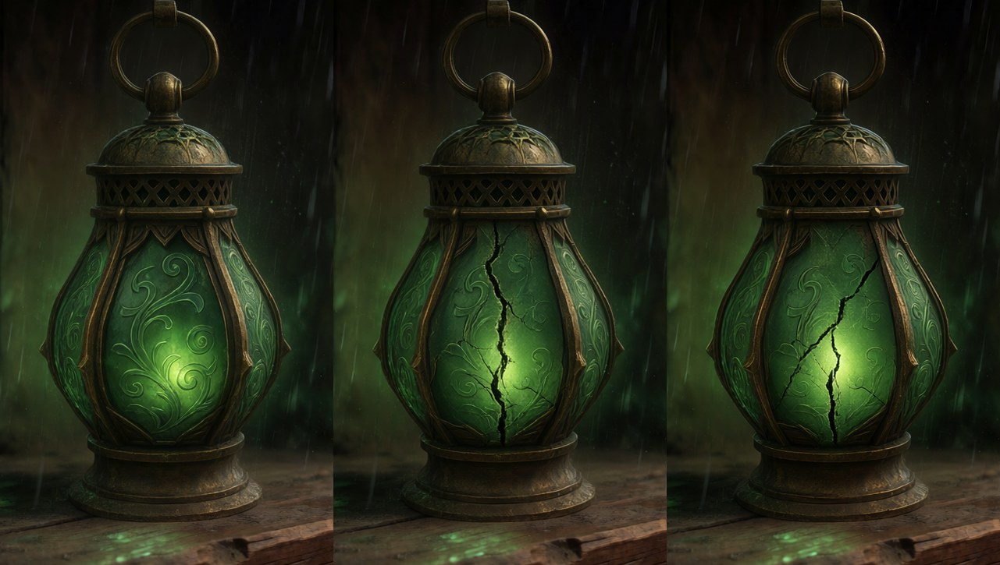

# A thing's reference sheet through the face pass (2026-11-26)

Stage 0 found a thing takes a sheet (the Lantern of Vael took its sheet's etching) once its state is named ("its green glass glowing"), on a bench prompt; the app's face pass speaks of a face ("the face and hair of the one in image 2", "keep … expression"), and an object had never been through it ([open threads](../../../../open-threads.md)). What the stage 6 check found of a thing's sheet: no head on it (`count.md`, none on each of the lantern's), its turns read as noise.

On the Windows PC's ComfyUI 0.46.3, sent from the Mac: a three-Frame tavern Storyboard with sheets from a Brief that makes stage 0's lantern a Subject, lit, beside Kael (`lantern.yaml`, `deno task replay … --on comfyui`, seed 7; Krea 2 + LoRA renders, Qwen-Image 2.1 int8 for the check and the face pass, Settings' edits pointed at the PC for the run and put back). Public material: the tavern's Kael and stage 0's lantern.

## Told as a face

The plan made the lantern a Subject (its identity the Brief's words), both sheets fit (33–36 s each; `01-sheet.jpg`), and the face pass found and repainted the lantern in all three Frames, told "Give the Lantern of Vael … the face and hair of the one in image 2. Keep the Lantern of Vael's expression exactly as in image 1 (<Kael's expression>) …" (`results/replay.log`, the call log). Then each render's lantern passed again by the app's code at seeds 10 and 11 (`run.sh`, `../marks/passes.ts`, `results/passes.log`), as built and with an instruction for a thing:

> Give the Lantern of Vael, the thing in the marked area of image 1, the look of the one in image 2: its shape, materials and details. Keep how it is lit and its state exactly as in image 1, the way it is turned, and everything else.

| The lantern | As a face (the app's run and 2 seeds) | As a thing (2 seeds) |
|---|---|---|
| A face painted into its glass | **3 of 3** where it stands alone (Frame 2) | none |
| Took the sheet's shape and etching | 4 of 6 (stayed as rendered once) | **6 of 6** |
| Kept its glow | 4 of 6, dimmer on 2 | 5 of 6, dimmer on 1 |

The app's run told as a face, each render beside its pass (Frame 2: a woman's face in the glass):

Each Frame's lantern before its pass, then as a face and as a thing, seeds 10 and 11:

## Built

- **A sheet's check keeps whether it's a thing's** (`SheetPicture.thing`, `session.json` v6): its count of heads, already asked (`count.md`), is none. A sheet made before v6, or not checked, is taken for a person's.
- **A thing is told as one** (`prompts/faces/thing.md`; after an edit told its change, `thing-edited.md`, below): neither the Frame's expression nor its clothing sentence is named, as both are about people.
- The same v6 keeps **a Storyboard Frame's clothing sentence apart** (`FrameImage.clothing`), as a Roleplay Frame's was, so its face pass names it too, as [marks/](../marks/README.md) built for a Roleplay; a Storyboard Frame written before v6 has none ('').

Through the app with it built (the same replay again, `results/replay-v6.log`): saved at v6, the lantern's sheet a thing's and Kael's a person's, each Frame's clothing sentence kept; the lantern told as a thing in all three Frames and Kael his clothing sentence named in his two. No face anywhere; the lantern took its sheet's shape and etching in all three, glowing, a little dimmer alone on the shelf; Kael his sheet's face. The same renders as the first run (the same seed), so the difference is the pass's:

## An edit over a thing

`thing-edited.md` through the app (the replay run once more, then `../edits/edit.sh`, `results/thing-edit.log`, the PC): a crack painted over the lantern alone on Frame 2 ("A long crack runs across the lantern's front pane of glass.", Qwen-Image 2.1 Edit), then its pass, told that instruction as the change to keep (seen in the call log), at 0.9 as the lantern's pass was in use. The crack kept, drawn a little differently; the lantern still its sheet's shape, glowing; 65 s (the edit 26 s). One seed. The render's pass, the edit, its pass:

## Files

- `lantern.yaml`: the replay. `run.sh`: the lantern's passes on the first run's renders.
- `results/`: the two replays and the passes, with the instruction each was told.
- Not kept: the three Sessions (deleted after), the passes' full-size pictures.
